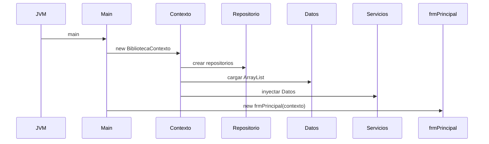
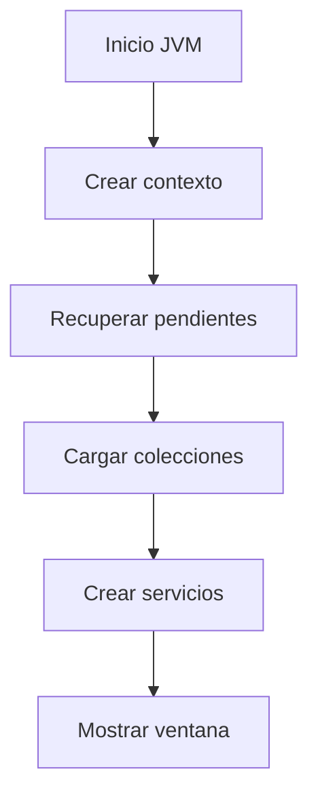

# Arquitectura general

## A. Perspectiva de negocio

El sistema organiza el catálogo y los préstamos en una aplicación de escritorio. El lector de esta sección es quien estudia el proyecto; no hay una operación de usuario que modifique datos.

Las ventanas reciben un BibliotecaContexto compartido. Las entidades viajan entre presentación, servicios y colecciones; los repositorios traducen a líneas de texto.

## B. Perspectiva técnica

La dirección habitual es forms → service → colecciones → repository; app construye las dependencias. clases contiene entidades; util aporta rutas, códigos y la selección temporal.

No todas las acciones siguen idéntica persistencia: usuarios requieren Guardar, categorías guardan al operar, autores y libros usan una transacción coordinada, y préstamos guardan tres archivos.

## C. Diagrama de secuencia



## D. Diagrama de flujo



## E. Código Java explicado

### `app.Main.main`

**Firma:** `public static void main(String[] args) {`  
**Fuente:** [Biblioteca/src/app/Main.java:13](../../Biblioteca/src/app/Main.java#L13)  
**Por qué participa:** Inicia Swing en el EDT.  
**Invocado por:** JVM  
**Invoca después:** BibliotecaContexto, frmPrincipal

```java
    public static void main(String[] args) {
        try {
            UIManager.setLookAndFeel("com.sun.java.swing.plaf.windows.WindowsLookAndFeel");
        } catch (Exception ignored) {
            // Swing conserva su apariencia predeterminada si el tema no está disponible.
        }
        EventQueue.invokeLater(() -> {
            try {
                frmPrincipal frame = new frmPrincipal(new BibliotecaContexto());
                frame.setLocationRelativeTo(null);
                frame.setVisible(true);
            } catch (RuntimeException error) {
```

### `app.BibliotecaContexto.BibliotecaContexto`

**Firma:** `public BibliotecaContexto() {`  
**Fuente:** [Biblioteca/src/app/BibliotecaContexto.java:36](../../Biblioteca/src/app/BibliotecaContexto.java#L36)  
**Por qué participa:** Compone repositorios, colecciones y servicios.  
**Invocado por:** Main.main  
**Invoca después:** TransaccionArchivos.recuperarPendiente, constructores Datos*

```java
    public BibliotecaContexto() {
        TransaccionArchivos.recuperarPendiente();
        usuarios = new DatosUsuario(new ArchivoTextoRepository<>(Rutas.dato("usuarios.txt"),
                Formatos::leerUsuario, Formatos::escribirUsuario));
        libros = new DatosLibro(new ArchivoTextoRepository<>(Rutas.dato("libros.txt"),
                Formatos::leerLibro, Formatos::escribirLibro));
        categorias = new DatosCategoria(new ArchivoTextoRepository<>(Rutas.dato("categorias.txt"),
                Formatos::leerCategoria, Formatos::escribirCategoria));
        prestamos = new DatosPrestamo(new ArchivoTextoRepository<>(Rutas.dato("prestamos.txt"),
                Formatos::leerPrestamo, Formatos::escribirPrestamo));
        detalles = new DatosDetallePrestamo(new ArchivoTextoRepository<>(Rutas.dato("detallePrestamo.txt"),
                Formatos::leerDetalle, Formatos::escribirDetalle), prestamos, libros);
```

### `repository.ArchivoTextoRepository.cargar`

**Firma:** `public ArrayList<T> cargar() {`  
**Fuente:** [Biblioteca/src/repository/ArchivoTextoRepository.java:25](../../Biblioteca/src/repository/ArchivoTextoRepository.java#L25)  
**Por qué participa:** Lee registros UTF-8.  
**Invocado por:** Datos*.recuperar  
**Invoca después:** Formatos.leer*

```java
    public ArrayList<T> cargar() {
        ArrayList<T> resultado = new ArrayList<>();
        try {
            int numero = 0;
            for (String linea : Files.readAllLines(archivo, StandardCharsets.UTF_8)) {
                numero++;
                try { resultado.add(leer.apply(linea)); }
                catch (RuntimeException error) {
                    throw new IllegalStateException("Registro inválido en " + archivo + ", línea " + numero, error);
                }
            }
            return resultado;
```

### `repository.ArchivoTextoRepository.guardar`

**Firma:** `public void guardar(ArrayList<T> registros) {`  
**Fuente:** [Biblioteca/src/repository/ArchivoTextoRepository.java:43](../../Biblioteca/src/repository/ArchivoTextoRepository.java#L43)  
**Por qué participa:** Sustituye un archivo de texto.  
**Invocado por:** Datos*.guardar  
**Invoca después:** Formatos.escribir*

```java
    public void guardar(ArrayList<T> registros) {
        Path temporal = null;
        try {
            ArrayList<String> lineas = new ArrayList<>();
            for (T registro : registros) lineas.add(escribir.apply(registro));
            temporal = Files.createTempFile(archivo.getParent(), archivo.getFileName().toString(), ".tmp");
            Files.write(temporal, lineas, StandardCharsets.UTF_8);
            try {
                Files.move(temporal, archivo, StandardCopyOption.ATOMIC_MOVE, StandardCopyOption.REPLACE_EXISTING);
            } catch (AtomicMoveNotSupportedException error) {
                Files.move(temporal, archivo, StandardCopyOption.REPLACE_EXISTING);
            }
```

### `util.Rutas.dato`

**Firma:** `public static Path dato(String nombre) {`  
**Fuente:** [Biblioteca/src/util/Rutas.java:28](../../Biblioteca/src/util/Rutas.java#L28)  
**Por qué participa:** Resuelve la ubicación de un .txt.  
**Invocado por:** BibliotecaContexto  
**Invoca después:** Rutas.raiz

```java
    public static Path dato(String nombre) {
        return raiz().resolve("datos").resolve(nombre);
    }
```

## F. Datos y persistencia

Estado: ArrayList en DatosUsuario, DatosCategoria, DatosAutor, DatosLibro, DatosPrestamo y DatosDetallePrestamo; DatosLibroDetalle conserva la selección temporal.

Archivos: usuarios.txt (6 campos), categorias.txt (2), autores.txt (2), libros.txt (9), libroAutor.txt (2), prestamos.txt (4), detallePrestamo.txt (4). Los dos archivos de autores pueden no existir todavía.

## G. Depuración en IntelliJ

Empieza en app.Main.main y entra con Step Into en el Runnable de EventQueue. Sigue BibliotecaContexto y luego el constructor de frmPrincipal.

Inspecciona contexto, las referencias a servicios y las listas de Datos*. Step Over en la construcción de widgets; Step Into cuando se cree cada repositorio.

## H. Pruebas

PruebasBiblioteca.main crea copias temporales y recorre operaciones de todas las capas. La inspección de la UI Swing y sus imágenes requiere ejecución manual en IntelliJ.

[Volver al explorador](../explorador/index.html)

## Inventario de dependencias internas

Mapa de `import` explícitos entre tipos del proyecto; las clases del mismo paquete pueden llamarse sin import.

- `Biblioteca/src/app/BibliotecaContexto.java` → `colecciones.DatosAutor`, `colecciones.DatosCategoria`, `colecciones.DatosDetallePrestamo`, `colecciones.DatosLibro`, `colecciones.DatosPrestamo`, `colecciones.DatosUsuario`, `repository.ArchivoTextoRepository`, `repository.Formatos`, `repository.TransaccionArchivos`, `service.AutorService`, `service.CategoriaService`, `service.LibroService`, `service.PortadaService`, `service.PrestamoService`, `service.UsuarioService`, `util.Rutas`
- `Biblioteca/src/app/Main.java` → `forms.frmPrincipal`
- `Biblioteca/src/clases/Autor.java` → sin imports internos explícitos
- `Biblioteca/src/clases/Categoria.java` → sin imports internos explícitos
- `Biblioteca/src/clases/DetallePrestamo.java` → sin imports internos explícitos
- `Biblioteca/src/clases/Libro.java` → sin imports internos explícitos
- `Biblioteca/src/clases/LibroAutor.java` → sin imports internos explícitos
- `Biblioteca/src/clases/Prestamo.java` → sin imports internos explícitos
- `Biblioteca/src/clases/Usuario.java` → sin imports internos explícitos
- `Biblioteca/src/colecciones/DatosAutor.java` → `clases.Autor`, `clases.Libro`, `clases.LibroAutor`, `repository.Repositorio`, `util.Codigos`, `util.Rutas`
- `Biblioteca/src/colecciones/DatosCategoria.java` → `clases.Categoria`, `repository.Repositorio`, `util.Codigos`
- `Biblioteca/src/colecciones/DatosDetallePrestamo.java` → `clases.DetallePrestamo`, `repository.Repositorio`, `util.Codigos`
- `Biblioteca/src/colecciones/DatosLibro.java` → `clases.Libro`, `repository.Repositorio`, `util.Codigos`
- `Biblioteca/src/colecciones/DatosPrestamo.java` → `clases.Prestamo`, `repository.Repositorio`, `util.Codigos`
- `Biblioteca/src/colecciones/DatosUsuario.java` → `clases.Usuario`, `repository.Repositorio`, `util.Codigos`
- `Biblioteca/src/forms/frmAutor.java` → `app.BibliotecaContexto`, `clases.Autor`, `service.AutorService`
- `Biblioteca/src/forms/frmBoleta.java` → `app.BibliotecaContexto`, `clases.DetallePrestamo`, `clases.Libro`, `clases.Prestamo`, `clases.Usuario`
- `Biblioteca/src/forms/frmCategoria.java` → `app.BibliotecaContexto`, `clases.Categoria`, `service.CategoriaService`
- `Biblioteca/src/forms/frmLibro.java` → `app.BibliotecaContexto`, `clases.Autor`, `clases.Categoria`, `clases.Libro`, `service.AutorService`, `service.CategoriaService`, `service.LibroService`, `service.PortadaService`, `util.Constante`, `util.Rutas`
- `Biblioteca/src/forms/frmListaPrestamo.java` → `app.BibliotecaContexto`, `clases.Prestamo`, `clases.Usuario`
- `Biblioteca/src/forms/frmPrincipal.java` → `app.BibliotecaContexto`, `clases.Libro`, `clases.Prestamo`, `clases.Usuario`, `util.DetalleLibro`
- `Biblioteca/src/forms/frmUsuario.java` → `app.BibliotecaContexto`, `clases.Usuario`, `colecciones.DatosUsuario`, `service.UsuarioService`
- `Biblioteca/src/forms/ImagenRenderer.java` → `util.Constante`, `util.Rutas`
- `Biblioteca/src/forms/TarjetasLibro.java` → `clases.Libro`, `util.Rutas`
- `Biblioteca/src/repository/ArchivoTextoRepository.java` → sin imports internos explícitos
- `Biblioteca/src/repository/Formatos.java` → `clases.Autor`, `clases.Categoria`, `clases.DetallePrestamo`, `clases.Libro`, `clases.LibroAutor`, `clases.Prestamo`, `clases.Usuario`
- `Biblioteca/src/repository/Repositorio.java` → sin imports internos explícitos
- `Biblioteca/src/repository/TransaccionArchivos.java` → `util.Rutas`
- `Biblioteca/src/service/AutorService.java` → `clases.Autor`, `clases.Libro`, `clases.LibroAutor`, `colecciones.DatosAutor`, `colecciones.DatosLibro`, `repository.TransaccionArchivos`
- `Biblioteca/src/service/CategoriaService.java` → `clases.Categoria`, `colecciones.DatosCategoria`
- `Biblioteca/src/service/LibroService.java` → `clases.Libro`, `colecciones.DatosLibro`
- `Biblioteca/src/service/PortadaService.java` → `util.Rutas`
- `Biblioteca/src/service/PrestamoService.java` → `clases.DetallePrestamo`, `clases.Libro`, `clases.Prestamo`, `clases.Usuario`, `colecciones.DatosDetallePrestamo`, `colecciones.DatosLibro`, `colecciones.DatosPrestamo`, `repository.TransaccionArchivos`, `util.DatosLibroDetalle`, `util.DetalleLibro`
- `Biblioteca/src/service/UsuarioService.java` → `clases.Usuario`, `colecciones.DatosUsuario`
- `Biblioteca/src/util/Codigos.java` → sin imports internos explícitos
- `Biblioteca/src/util/Constante.java` → sin imports internos explícitos
- `Biblioteca/src/util/DatosLibroDetalle.java` → `clases.Libro`
- `Biblioteca/src/util/DetalleLibro.java` → `clases.Libro`
- `Biblioteca/src/util/Rutas.java` → sin imports internos explícitos
