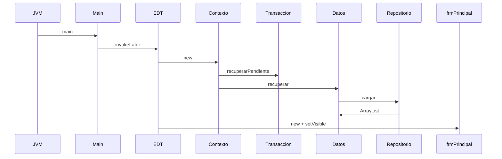
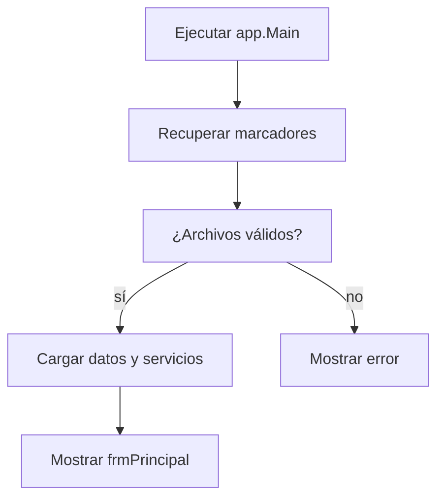

# Arranque e inicialización

## A. Perspectiva de negocio

El usuario ejecuta la configuración Biblioteca de IntelliJ. No introduce datos en este paso; espera que abra la ventana principal con catálogo y usuarios.

Un archivo inválido o una recuperación pendiente imposible impide abrir la aplicación y se muestra un mensaje de error.

## B. Perspectiva técnica

Main.main configura la apariencia y programa la creación de frmPrincipal en EventQueue. BibliotecaContexto recupera transacciones pendientes antes de cargar colecciones.

Cada Datos* carga su repositorio al construirse. DatosAutor enlaza autores históricos en memoria si faltan los archivos nuevos. frmPrincipal crea menús, repisa y selector de usuarios.

## C. Diagrama de secuencia



## D. Diagrama de flujo



## E. Código Java explicado

### `app.Main.main`

**Firma:** `public static void main(String[] args) {`  
**Fuente:** [Biblioteca/src/app/Main.java:13](../../Biblioteca/src/app/Main.java#L13)  
**Por qué participa:** Punto de entrada único.  
**Invocado por:** JVM  
**Invoca después:** EventQueue.invokeLater, BibliotecaContexto

```java
    public static void main(String[] args) {
        try {
            UIManager.setLookAndFeel("com.sun.java.swing.plaf.windows.WindowsLookAndFeel");
        } catch (Exception ignored) {
            // Swing conserva su apariencia predeterminada si el tema no está disponible.
        }
        EventQueue.invokeLater(() -> {
            try {
                frmPrincipal frame = new frmPrincipal(new BibliotecaContexto());
                frame.setLocationRelativeTo(null);
                frame.setVisible(true);
            } catch (RuntimeException error) {
```

### `repository.TransaccionArchivos.recuperarPendiente`

**Firma:** `public static void recuperarPendiente() {`  
**Fuente:** [Biblioteca/src/repository/TransaccionArchivos.java:19](../../Biblioteca/src/repository/TransaccionArchivos.java#L19)  
**Por qué participa:** Restituye escrituras interrumpidas.  
**Invocado por:** BibliotecaContexto  
**Invoca después:** recuperarAutores, Files.copy

```java
    public static void recuperarPendiente() {
        recuperarAutores();
        Path marcador = Rutas.dato(MARCADOR);
        if (!Files.exists(marcador)) return;
        try {
            for (String nombre : ARCHIVOS) {
                Path respaldo = Rutas.dato(nombre + ".prestamo.bak");
                if (!Files.exists(respaldo)) throw new IOException("Falta respaldo de " + nombre);
            }
            for (String nombre : ARCHIVOS) {
                Files.copy(Rutas.dato(nombre + ".prestamo.bak"), Rutas.dato(nombre),
                        StandardCopyOption.REPLACE_EXISTING);
```

### `app.BibliotecaContexto.BibliotecaContexto`

**Firma:** `public BibliotecaContexto() {`  
**Fuente:** [Biblioteca/src/app/BibliotecaContexto.java:36](../../Biblioteca/src/app/BibliotecaContexto.java#L36)  
**Por qué participa:** Construye el grafo de dependencias.  
**Invocado por:** Main.main  
**Invoca después:** Datos*, servicios

```java
    public BibliotecaContexto() {
        TransaccionArchivos.recuperarPendiente();
        usuarios = new DatosUsuario(new ArchivoTextoRepository<>(Rutas.dato("usuarios.txt"),
                Formatos::leerUsuario, Formatos::escribirUsuario));
        libros = new DatosLibro(new ArchivoTextoRepository<>(Rutas.dato("libros.txt"),
                Formatos::leerLibro, Formatos::escribirLibro));
        categorias = new DatosCategoria(new ArchivoTextoRepository<>(Rutas.dato("categorias.txt"),
                Formatos::leerCategoria, Formatos::escribirCategoria));
        prestamos = new DatosPrestamo(new ArchivoTextoRepository<>(Rutas.dato("prestamos.txt"),
                Formatos::leerPrestamo, Formatos::escribirPrestamo));
        detalles = new DatosDetallePrestamo(new ArchivoTextoRepository<>(Rutas.dato("detallePrestamo.txt"),
                Formatos::leerDetalle, Formatos::escribirDetalle), prestamos, libros);
```

### `colecciones.DatosAutor.DatosAutor`

**Firma:** `public DatosAutor(Repositorio<Autor> repositorio, Repositorio<LibroAutor> relacionesRepositorio, ArrayList<Libro> libros) {`  
**Fuente:** [Biblioteca/src/colecciones/DatosAutor.java:21](../../Biblioteca/src/colecciones/DatosAutor.java#L21)  
**Por qué participa:** Carga o deriva asociaciones históricas.  
**Invocado por:** BibliotecaContexto  
**Invoca después:** repositorio.cargar, validar

```java
    public DatosAutor(Repositorio<Autor> repositorio, Repositorio<LibroAutor> relacionesRepositorio,
                     ArrayList<Libro> libros) {
        this.repositorio = repositorio;
        this.relacionesRepositorio = relacionesRepositorio;
        boolean hayAutores = Files.exists(Rutas.dato("autores.txt"));
        boolean hayRelaciones = Files.exists(Rutas.dato("libroAutor.txt"));
        if (hayAutores != hayRelaciones)
            throw new IllegalStateException("Falta autores.txt o libroAutor.txt; no se modificaron los datos");
        if (hayAutores) {
            autores.addAll(repositorio.cargar());
            relaciones.addAll(relacionesRepositorio.cargar());
        }
```

### `forms.frmPrincipal.frmPrincipal`

**Firma:** `public frmPrincipal(BibliotecaContexto contexto) {`  
**Fuente:** [Biblioteca/src/forms/frmPrincipal.java:77](../../Biblioteca/src/forms/frmPrincipal.java#L77)  
**Por qué participa:** Crea la ventana y conecta menús.  
**Invocado por:** Main.main  
**Invoca después:** cargarRepisa, agregarUsuariosCombo

```java
	public frmPrincipal(BibliotecaContexto contexto) {
		this.contexto = contexto;
		setResizable(false);
		setTitle("Biblioteca");
		setDefaultCloseOperation(JFrame.EXIT_ON_CLOSE);
		setBounds(100, 100, 1173, 786);

		menuBar = new JMenuBar();
		setJMenuBar(menuBar);

		mnMantenimiento = new JMenu("Mantenimiento");
		menuBar.add(mnMantenimiento);
```

## F. Datos y persistencia

Lectura al arrancar: cinco archivos históricos; autores.txt y libroAutor.txt solo si existen ambos. Si una colección inicial está vacía, DatosUsuario, DatosCategoria o DatosLibro puede insertar y guardar valores iniciales.

La migración histórica de autores no escribe al arrancar. La recuperación de transacciones sí puede restaurar respaldos si existe un marcador pendiente.

## G. Depuración en IntelliJ

Breakpoint en Main.main:13, luego BibliotecaContexto.BibliotecaContexto y TransaccionArchivos.recuperarPendiente.

Inspecciona biblioteca.home, Rutas.raiz(), existencia de marcadores, listas cargadas y tamaño de cada colección. Step Into en recuperar; Step Over sobre la creación de cada repositorio.

## H. Pruebas

PruebasBiblioteca.main comprueba recarga, datos corruptos, P20 y recuperación de marcadores. Abrir la ventana y validar la apariencia es manual.

[Volver al explorador](../explorador/index.html)
