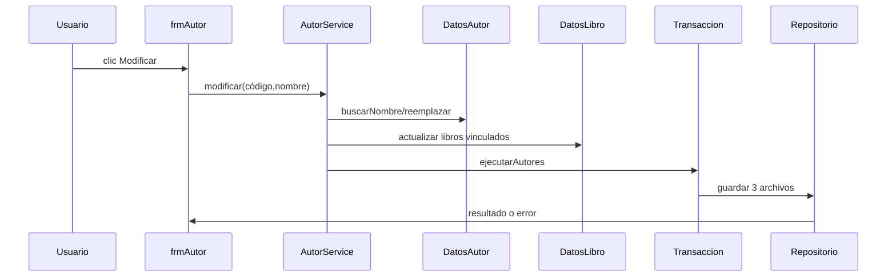
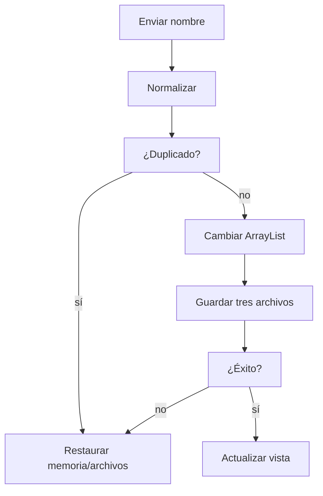

# Gestión de autores

## A. Perspectiva de negocio

Desde Mantenimiento → Autor se puede registrar, buscar, renombrar o eliminar un autor. Cada libro tiene un autor principal; un autor puede figurar en varios libros.

Los nombres duplicados por espacios o mayúsculas se rechazan. No se elimina un autor con libros asociados. Renombrarlo cambia también el texto del autor en esos libros.

## B. Perspectiva técnica

frmAutor llama AutorService. DatosAutor conserva dos ArrayList: autores y LibroAutor. Si no existen los archivos nuevos, su constructor deriva vínculos históricos en memoria, sin escritura inmediata.

AutorService.cambiar hace copia de las listas, aplica la mutación y guarda autores.txt, libroAutor.txt y libros.txt mediante TransaccionArchivos.ejecutarAutores; restaura memoria ante RuntimeException.

## C. Diagrama de secuencia



## D. Diagrama de flujo



## E. Código Java explicado

### `forms.frmAutor.ejecutar`

**Firma:** `private void ejecutar(Runnable operacion) {`  
**Fuente:** [Biblioteca/src/forms/frmAutor.java:92](../../Biblioteca/src/forms/frmAutor.java#L92)  
**Por qué participa:** Envuelve la acción del botón y muestra errores.  
**Invocado por:** JButtons de frmAutor  
**Invoca después:** AutorService.registrar/modificar/eliminar

```java
    private void ejecutar(Runnable operacion) {
        try {
            operacion.run();
            cargar(autores.listar()); limpiar(); actualizarLibros.run();
        } catch (RuntimeException error) {
            JOptionPane.showMessageDialog(this, error.getMessage(), "Autor", JOptionPane.ERROR_MESSAGE);
        }
    }
```

### `service.AutorService.registrar`

**Firma:** `public Autor registrar(String nombre) {`  
**Fuente:** [Biblioteca/src/service/AutorService.java:33](../../Biblioteca/src/service/AutorService.java#L33)  
**Por qué participa:** Normaliza y rechaza duplicados.  
**Invocado por:** frmAutor.ejecutar  
**Invoca después:** DatosAutor.buscarNombre, cambiar

```java
    public Autor registrar(String nombre) {
        String limpio = DatosAutor.limpiarNombre(nombre);
        if (datos.buscarNombre(limpio) != null) throw new IllegalArgumentException("El autor ya existe");
        Autor autor = new Autor(datos.siguienteCodigo(), limpio);
        cambiar(() -> datos.agregar(autor));
        return autor;
    }
```

### `service.AutorService.modificar`

**Firma:** `public void modificar(String codigo, String nombre) {`  
**Fuente:** [Biblioteca/src/service/AutorService.java:41](../../Biblioteca/src/service/AutorService.java#L41)  
**Por qué participa:** Propaga el nombre a libros relacionados.  
**Invocado por:** frmAutor.ejecutar  
**Invoca después:** DatosAutor.reemplazar, DatosLibro.actualizar, cambiar

```java
    public void modificar(String codigo, String nombre) {
        Autor anterior = exigir(codigo);
        String limpio = DatosAutor.limpiarNombre(nombre);
        Autor duplicado = datos.buscarNombre(limpio);
        if (duplicado != null && !duplicado.getCodigo().equals(codigo))
            throw new IllegalArgumentException("El autor ya existe");
        cambiar(() -> {
            datos.reemplazar(new Autor(codigo, limpio));
            for (Libro libro : libros.listar()) {
                if (!codigo.equals(datos.codigoDeLibro(libro.getCodLibro()))) continue;
                Libro copia = new Libro(libro.getCodLibro(), libro.getTitulo(), limpio, libro.getIsnb(),
                        libro.getCodCategoria(), libro.getAnioPublicacion(), libro.getCantidadDisponible(),
```

### `service.AutorService.eliminar`

**Firma:** `public void eliminar(String codigo) {`  
**Fuente:** [Biblioteca/src/service/AutorService.java:59](../../Biblioteca/src/service/AutorService.java#L59)  
**Por qué participa:** Bloquea bajas con libros asociados.  
**Invocado por:** frmAutor.ejecutar  
**Invoca después:** DatosAutor.tieneLibros, cambiar

```java
    public void eliminar(String codigo) {
        exigir(codigo);
        if (datos.tieneLibros(codigo)) throw new IllegalArgumentException("El autor tiene libros asociados");
        cambiar(() -> datos.eliminar(codigo));
    }
```

### `service.AutorService.cambiar`

**Firma:** `private void cambiar(Runnable accion) {`  
**Fuente:** [Biblioteca/src/service/AutorService.java:99](../../Biblioteca/src/service/AutorService.java#L99)  
**Por qué participa:** Coordina memoria y tres archivos.  
**Invocado por:** AutorService.registrar/modificar/eliminar  
**Invoca después:** TransaccionArchivos.ejecutarAutores

```java
    private void cambiar(Runnable accion) {
        ArrayList<Autor> autoresAntes = datos.listar();
        ArrayList<LibroAutor> relacionesAntes = datos.relaciones();
        ArrayList<Libro> librosAntes = libros.listar();
        try {
            accion.run();
            TransaccionArchivos.ejecutarAutores(() -> { datos.guardar(); libros.guardar(); },
                    "autores.txt", "libroAutor.txt", "libros.txt");
        } catch (RuntimeException error) {
            datos.restaurar(autoresAntes, relacionesAntes);
            libros.restaurar(librosAntes);
            throw error;
```

### `colecciones.DatosAutor.DatosAutor`

**Firma:** `public DatosAutor(Repositorio<Autor> repositorio, Repositorio<LibroAutor> relacionesRepositorio, ArrayList<Libro> libros) {`  
**Fuente:** [Biblioteca/src/colecciones/DatosAutor.java:21](../../Biblioteca/src/colecciones/DatosAutor.java#L21)  
**Por qué participa:** Carga o deriva autores históricos.  
**Invocado por:** BibliotecaContexto  
**Invoca después:** repositorio.cargar, validar

```java
    public DatosAutor(Repositorio<Autor> repositorio, Repositorio<LibroAutor> relacionesRepositorio,
                     ArrayList<Libro> libros) {
        this.repositorio = repositorio;
        this.relacionesRepositorio = relacionesRepositorio;
        boolean hayAutores = Files.exists(Rutas.dato("autores.txt"));
        boolean hayRelaciones = Files.exists(Rutas.dato("libroAutor.txt"));
        if (hayAutores != hayRelaciones)
            throw new IllegalStateException("Falta autores.txt o libroAutor.txt; no se modificaron los datos");
        if (hayAutores) {
            autores.addAll(repositorio.cargar());
            relaciones.addAll(relacionesRepositorio.cargar());
        }
```

### `repository.TransaccionArchivos.ejecutarAutores`

**Firma:** `public static void ejecutarAutores(Runnable operacion, String... nombres) {`  
**Fuente:** [Biblioteca/src/repository/TransaccionArchivos.java:40](../../Biblioteca/src/repository/TransaccionArchivos.java#L40)  
**Por qué participa:** Crea respaldos y marcador.  
**Invocado por:** AutorService.cambiar  
**Invoca después:** recuperarAutores

```java
    public static void ejecutarAutores(Runnable operacion, String... nombres) {
        Path marcador = Rutas.dato(".autores-pendiente");
        if (Files.exists(marcador)) throw new IllegalStateException("Existe una operación de autores pendiente");
        ArrayList<String> estado = new ArrayList<>();
        try {
            for (String nombre : nombres) {
                Path archivo = Rutas.dato(nombre);
                boolean existe = Files.exists(archivo);
                estado.add(nombre + ";" + existe);
                if (existe) Files.copy(archivo, Rutas.dato(nombre + ".autores.bak"), StandardCopyOption.REPLACE_EXISTING);
                else Files.deleteIfExists(Rutas.dato(nombre + ".autores.bak"));
            }
```

## F. Datos y persistencia

Autor: A* String y nombre; LibroAutor: codLibro y codAutor String. autores.txt: código;nombre. libroAutor.txt: códigoLibro;códigoAutor. libros.txt conserva el autor en su tercera columna.

Los tres archivos se escriben juntos al modificar autores o libros. Un marcador .autores-pendiente y respaldos permiten recuperar un guardado interrumpido.

## G. Depuración en IntelliJ

Breakpoint en frmAutor.ejecutar y después AutorService.registrar/modificar/eliminar. En el cambio de nombre entra en el bucle de AutorService.modificar.

Inspecciona clave normalizada, autor duplicado, relaciones, libros afectados y los tres archivos. Step Into en cambiar y ejecutarAutores; Step Over en la actualización de la tabla.

## H. Pruebas

PruebasBiblioteca.probarAutores verifica vínculos históricos, duplicados, renombrado, baja bloqueada, persistencia y recuperación ante escrituras parciales. La ventana y el menú se prueban manualmente.

[Volver al explorador](../explorador/index.html)
