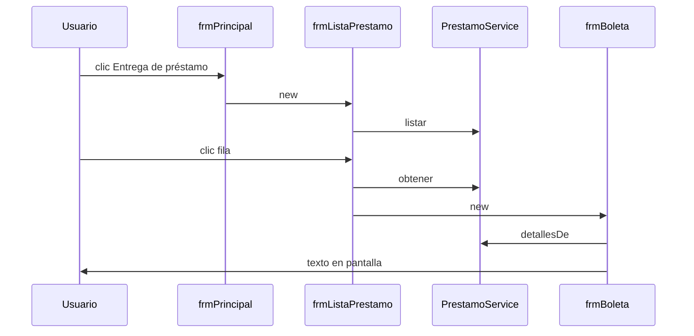
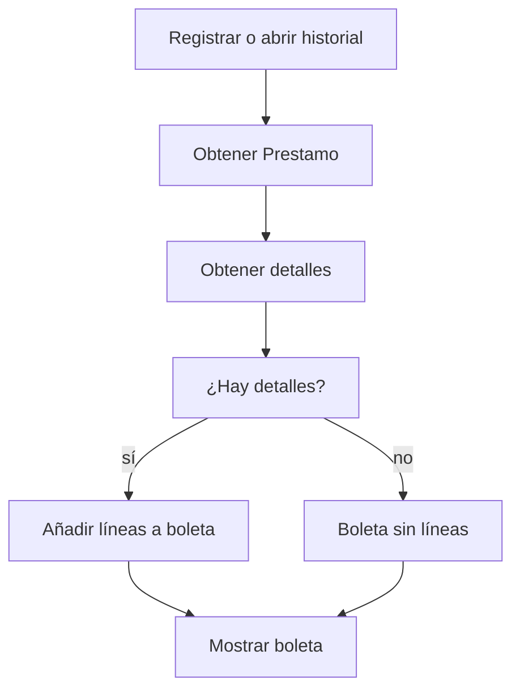

# Boletas e historial

## A. Perspectiva de negocio

Tras registrar un préstamo aparece una boleta con usuario, fechas y libros. El menú Proceso → Entrega de préstamo abre una lista histórica; al elegir una fila se muestra su boleta.

La opción se llama Entrega, pero actualmente solo consulta historial: no registra devolución ni repone existencias. P20 muestra una boleta sin líneas de detalle.

## B. Perspectiva técnica

frmPrincipal crea frmBoleta tras registrar o frmListaPrestamo desde el menú. La lista obtiene PrestamoService.listar; un clic busca el préstamo por código y abre frmBoleta.

frmBoleta.generarBoleta consulta detallesDe, nombre de usuario y título actual de cada libro. El texto se compone en un JTextArea; no crea un archivo de boleta.

## C. Diagrama de secuencia



## D. Diagrama de flujo



## E. Código Java explicado

### `forms.frmPrincipal.actionPerformedMntmEntregaPrestamo`

**Firma:** `protected void actionPerformedMntmEntregaPrestamo(ActionEvent e) {`  
**Fuente:** [Biblioteca/src/forms/frmPrincipal.java:366](../../Biblioteca/src/forms/frmPrincipal.java#L366)  
**Por qué participa:** Abre historial.  
**Invocado por:** Menú Entrega de préstamo  
**Invoca después:** frmListaPrestamo

```java
	protected void actionPerformedMntmEntregaPrestamo(ActionEvent e) {
		frmListaPrestamo listaPrestamo = new frmListaPrestamo(contexto, this::limpiarAgregados);
		listaPrestamo.setLocationRelativeTo(null);
		listaPrestamo.setVisible(true);
	}
```

### `forms.frmListaPrestamo.cargarListado`

**Firma:** `public void cargarListado() {`  
**Fuente:** [Biblioteca/src/forms/frmListaPrestamo.java:63](../../Biblioteca/src/forms/frmListaPrestamo.java#L63)  
**Por qué participa:** Llena la tabla de préstamos.  
**Invocado por:** constructor frmListaPrestamo  
**Invoca después:** PrestamoService.listar

```java
	public void cargarListado() {
		DefaultTableModel modelo = (DefaultTableModel) tbPrestamo.getModel();
		modelo.setRowCount(0);

		for (Prestamo p : contexto.prestamos().listar()) {

			Object[] fila = { p.getCodPrestamo(), p.getCodUsuario(), obtenerNombreUsuario(p.getCodUsuario()),
					p.getFechaPrestamo(), p.getFechaDevolucion() };

			modelo.addRow(fila);
		}
	}
```

### `forms.frmListaPrestamo.mouseClickedTbPrestamo`

**Firma:** `protected void mouseClickedTbPrestamo(MouseEvent e) {`  
**Fuente:** [Biblioteca/src/forms/frmListaPrestamo.java:93](../../Biblioteca/src/forms/frmListaPrestamo.java#L93)  
**Por qué participa:** Obtiene el préstamo seleccionado.  
**Invocado por:** JTable mouseClicked  
**Invoca después:** PrestamoService.obtener, frmBoleta

```java
	protected void mouseClickedTbPrestamo(MouseEvent e) {
		int i = tbPrestamo.getSelectedRow();
		
		String codPrestamo = tbPrestamo.getValueAt(i, 0).toString();
		Prestamo p = contexto.prestamos().obtener(codPrestamo);
		
		frmBoleta boleta = new frmBoleta(contexto, p, limpiarSeleccion);
		boleta.setLocationRelativeTo(null);
		boleta.setVisible(true);
	}
```

### `forms.frmBoleta.generarBoleta`

**Firma:** `private void generarBoleta() {`  
**Fuente:** [Biblioteca/src/forms/frmBoleta.java:64](../../Biblioteca/src/forms/frmBoleta.java#L64)  
**Por qué participa:** Compone el texto de boleta.  
**Invocado por:** constructor frmBoleta  
**Invoca después:** PrestamoService.detallesDe, obtenerNombreUsuario, obtenerTituloLibro

```java
	private void generarBoleta() {
		
		StringBuilder boleta = new StringBuilder();

		DateTimeFormatter formato = DateTimeFormatter.ofPattern("dd-MM-yyyy");

		boleta.append("========================================\n");
		boleta.append("              BIBLIOTECA\n");
		boleta.append("          BOLETA DE PRESTAMO\n");
		boleta.append("========================================\n");

		boleta.append(String.format("%-15s %s%n", "Prestamo:", prestamo.getCodPrestamo()));
```

### `service.PrestamoService.detallesDe`

**Firma:** `public ArrayList<DetallePrestamo> detallesDe(String codigo) {`  
**Fuente:** [Biblioteca/src/service/PrestamoService.java:40](../../Biblioteca/src/service/PrestamoService.java#L40)  
**Por qué participa:** Filtra por código.  
**Invocado por:** frmBoleta.generarBoleta  
**Invoca después:** DatosDetallePrestamo.listar

```java
    public ArrayList<DetallePrestamo> detallesDe(String codigo) {
        ArrayList<DetallePrestamo> resultado = new ArrayList<>();
        for (DetallePrestamo d : detalles.listar()) {
            if (d.getCodPrestamo().equals(codigo)) resultado.add(d);
        }
        return resultado;
    }
```

### `forms.frmBoleta.obtenerTituloLibro`

**Firma:** `public String obtenerTituloLibro(String codLibro) {`  
**Fuente:** [Biblioteca/src/forms/frmBoleta.java:141](../../Biblioteca/src/forms/frmBoleta.java#L141)  
**Por qué participa:** Resuelve título actual.  
**Invocado por:** frmBoleta.generarBoleta  
**Invoca después:** LibroService.obtener

```java
	public String obtenerTituloLibro(String codLibro) {
		for (int i = 0; i < contexto.libros().longitud(); i++) {
			Libro l = contexto.libros().obtener(i);

			if (l.getCodLibro().equals(codLibro)) {
				return l.getTitulo();
			}

		}
		return "";
	}
```

## F. Datos y persistencia

Lectura en memoria: ArrayList<Prestamo>, ArrayList<DetallePrestamo>, usuarios y libros. Los datos ya fueron cargados desde prestamos.txt, detallePrestamo.txt, usuarios.txt y libros.txt al arrancar.

Si se eliminó el libro, obtenerTituloLibro devuelve cadena vacía; el nombre de usuario ausente se muestra como Usuario no encontrado.

## G. Depuración en IntelliJ

Breakpoint en frmPrincipal.actionPerformedMntmEntregaPrestamo para historial o en frmBoleta.generarBoleta para boleta nueva.

Sigue frmListaPrestamo.cargarListado → mouseClickedTbPrestamo → PrestamoService.detallesDe. Inspecciona codPrestamo, filas, detalles y StringBuilder boleta.

## H. Pruebas

PruebasBiblioteca comprueba recuperación de préstamos y detalles, pero no el texto ni la visualización de la boleta. Abrir P20 y otra boleta en IntelliJ queda como prueba manual.

[Volver al explorador](../explorador/index.html)
