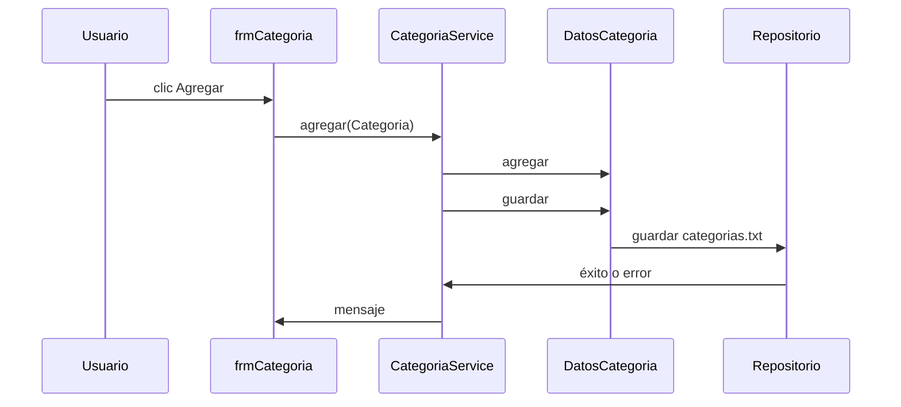
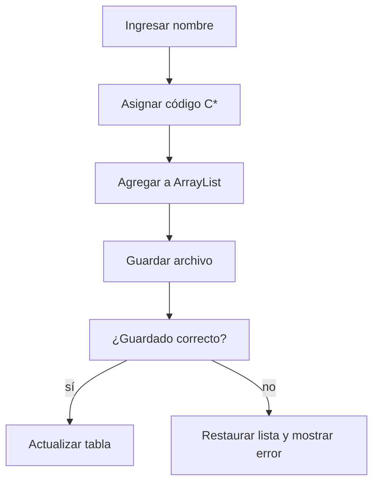

# Gestión de categorías

## A. Perspectiva de negocio

Desde Mantenimiento → Categoría se registran, buscan, modifican y eliminan géneros por nombre. La tabla refleja el catálogo disponible.

El código C* se asigna al agregar. El formulario muestra las excepciones; el servicio revierte el ArrayList si falla el guardado.

## B. Perspectiva técnica

frmCategoria enlaza botones con CategoriaService. Este delega a DatosCategoria, que mantiene ArrayList y llama a Repositorio.guardar durante cada alta, edición o baja.

La búsqueda usa el texto normalizado sin tildes. frmLibro consulta categorías para su JComboBox y usa codCategoria en Libro.

## C. Diagrama de secuencia



## D. Diagrama de flujo



## E. Código Java explicado

### `forms.frmCategoria.actionPerformedBtnAgregar`

**Firma:** `protected void actionPerformedBtnAgregar(ActionEvent e) {`  
**Fuente:** [Biblioteca/src/forms/frmCategoria.java:166](../../Biblioteca/src/forms/frmCategoria.java#L166)  
**Por qué participa:** Lee el nombre y crea Categoria.  
**Invocado por:** JButton Agregar  
**Invoca después:** CategoriaService.agregar

```java
	protected void actionPerformedBtnAgregar(ActionEvent e) {

		try {
			String nombre = txtCategoria.getText();

			String mensaje = dataCategoria.agregar(new Categoria(nombre));

			JOptionPane.showMessageDialog(null, mensaje);


			cargarData();

```

### `service.CategoriaService.agregar`

**Firma:** `public String agregar(Categoria categoria) {`  
**Fuente:** [Biblioteca/src/service/CategoriaService.java:15](../../Biblioteca/src/service/CategoriaService.java#L15)  
**Por qué participa:** Coordina mutación y guardado con reversión.  
**Invocado por:** frmCategoria.actionPerformedBtnAgregar  
**Invoca después:** DatosCategoria.agregar, guardar

```java
    public String agregar(Categoria categoria) {
        ArrayList<Categoria> antes = datos.listar();
        try { String r = datos.agregar(categoria); datos.guardar(); return r; }
        catch (RuntimeException error) { datos.restaurar(antes); throw error; }
    }
```

### `colecciones.DatosCategoria.agregar`

**Firma:** `public String agregar(Categoria cat) {`  
**Fuente:** [Biblioteca/src/colecciones/DatosCategoria.java:42](../../Biblioteca/src/colecciones/DatosCategoria.java#L42)  
**Por qué participa:** Asigna C* y añade al ArrayList.  
**Invocado por:** CategoriaService.agregar  
**Invoca después:** asignarCodigo

```java
	public String agregar(Categoria cat) {
		asignarCodigo(cat);
		categorias.add(cat);
		return "Registro de categoría agregado";
	}
```

### `colecciones.DatosCategoria.buscar`

**Firma:** `public ArrayList<Categoria> buscar(String busqueda) {`  
**Fuente:** [Biblioteca/src/colecciones/DatosCategoria.java:95](../../Biblioteca/src/colecciones/DatosCategoria.java#L95)  
**Por qué participa:** Filtra nombres sin tildes.  
**Invocado por:** CategoriaService.buscar  
**Invoca después:** DatosLibro.quitarTildes

```java
	public ArrayList<Categoria> buscar(String busqueda) {

		categoriaAgregado.clear();

		Categoria l = new Categoria();

		busqueda = DatosLibro.quitarTildes(busqueda).toLowerCase();

		for (int i = 0; i < longitud(); i++) {
			l = obtener(i);

			if (DatosLibro.quitarTildes(l.getNombre().toLowerCase()).contains(busqueda)) {
```

### `colecciones.DatosCategoria.guardar`

**Firma:** `public String guardar() {`  
**Fuente:** [Biblioteca/src/colecciones/DatosCategoria.java:115](../../Biblioteca/src/colecciones/DatosCategoria.java#L115)  
**Por qué participa:** Persiste la lista.  
**Invocado por:** CategoriaService.agregar/actualizar/eliminar  
**Invoca después:** Repositorio.guardar

```java
	public String guardar() {
		repositorio.guardar(new ArrayList<>(categorias));
		return "Se han guardado " + categorias.size() + " registros de categorías";
	}
```

### `repository.Formatos.escribirCategoria`

**Firma:** `public static String escribirCategoria(Categoria x) { return x.getCodCategoria() + ";" + x.getNombre(); }`  
**Fuente:** [Biblioteca/src/repository/Formatos.java:35](../../Biblioteca/src/repository/Formatos.java#L35)  
**Por qué participa:** Serializa código y nombre.  
**Invocado por:** ArchivoTextoRepository.guardar  
**Invoca después:** getters de Categoria

```java
    public static String escribirCategoria(Categoria x) { return x.getCodCategoria() + ";" + x.getNombre(); }
```

## F. Datos y persistencia

Categoria: codCategoria String y nombre. categorias.txt: código;nombre. El repositorio sustituye el archivo tras serializar cada registro.

Eliminar una categoría no valida aquí si hay libros asociados; el flujo actual no implementa esa regla.

## G. Depuración en IntelliJ

Empieza en frmCategoria.actionPerformedBtnAgregar. Sigue CategoriaService.agregar → DatosCategoria.agregar → DatosCategoria.guardar → ArchivoTextoRepository.guardar.

Inspecciona nombre, codCategoria, lista antes/después y ruta de categorias.txt. Para búsqueda, entra en DatosCategoria.buscar.

## H. Pruebas

PruebasBiblioteca.main comprueba alta, edición y baja de categoría con recarga. La interacción visual y la selección en frmLibro requieren revisión manual.

[Volver al explorador](../explorador/index.html)
