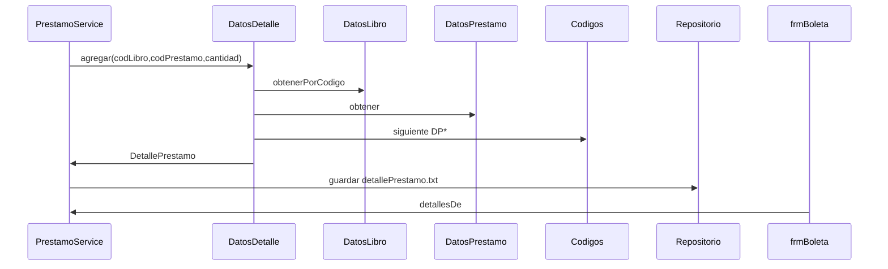
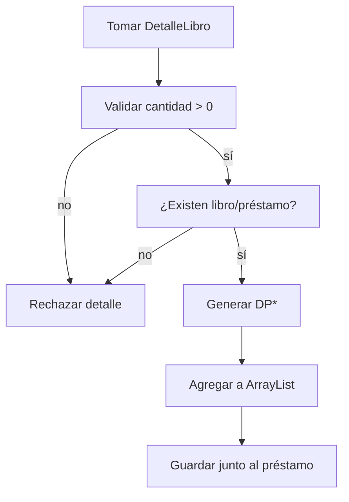

# Detalle de préstamos

## A. Perspectiva de negocio

El detalle registra qué libros y cuántos ejemplares pertenecen a cada préstamo. No se introduce por una pantalla independiente: surge de la selección realizada antes de confirmar.

Cada registro debe tener cantidad positiva y referirse a un libro y préstamo existentes. P20 se conserva sin detalles históricos; no se crean líneas faltantes automáticamente.

## B. Perspectiva técnica

PrestamoService.registrar itera DetalleLibro y llama DatosDetallePrestamo.agregar(codLibro, codPrestamo, cantidad). Esta colección valida referencias, asigna DP* y añade DetallePrestamo al ArrayList.

PrestamoService.detallesDe filtra por codPrestamo para boletas. DatosDetallePrestamo.guardar escribe la colección completa durante la transacción del préstamo.

## C. Diagrama de secuencia



## D. Diagrama de flujo



## E. Código Java explicado

### `service.PrestamoService.registrar`

**Firma:** `public Prestamo registrar(Usuario usuario, LocalDate fecha, LocalDate devolucion) {`  
**Fuente:** [Biblioteca/src/service/PrestamoService.java:48](../../Biblioteca/src/service/PrestamoService.java#L48)  
**Por qué participa:** Produce un detalle por libro seleccionado.  
**Invocado por:** frmPrincipal.actionPerformedBtnEjecutarPrestamo  
**Invoca después:** DatosDetallePrestamo.agregar

```java
    public Prestamo registrar(Usuario usuario, LocalDate fecha, LocalDate devolucion) {
        if (usuario == null) throw new IllegalArgumentException("Seleccione un usuario");
        if (seleccion.longitud() == 0) throw new IllegalArgumentException("Seleccione al menos un libro");
        for (DetalleLibro elegido : seleccion.listar()) {
            Libro libro = libros.obtenerPorCodigo(elegido.getLibro().getCodLibro());
            if (libro == null) throw new IllegalArgumentException("El libro seleccionado ya no existe");
            if (elegido.getCantidad() <= 0 || elegido.getCantidad() > libro.getCantidadDisponible()) {
                throw new IllegalArgumentException("No hay ejemplares disponibles de " + libro.getTitulo());
            }
        }

        Prestamo prestamo = new Prestamo(usuario.getCodUser(), fecha, devolucion);
```

### `colecciones.DatosDetallePrestamo.agregar`

**Firma:** `public String agregar(String codLibro, String codPrestamo, int cantPrestamo) {`  
**Fuente:** [Biblioteca/src/colecciones/DatosDetallePrestamo.java:31](../../Biblioteca/src/colecciones/DatosDetallePrestamo.java#L31)  
**Por qué participa:** Asigna DP* y añade a memoria.  
**Invocado por:** PrestamoService.registrar  
**Invoca después:** validar, Codigos.siguiente

```java
	public String agregar(String codLibro, String codPrestamo, int cantPrestamo) {
		validar(codLibro, codPrestamo, cantPrestamo);

		DetallePrestamo dp = new DetallePrestamo(codLibro, codPrestamo, cantPrestamo);
		dp.setCodDetallePrestamo(Codigos.siguiente("DP", 0, 10,
				detallePrestamos.stream().map(DetallePrestamo::getCodDetallePrestamo).filter(java.util.Objects::nonNull).toList()));
		if (detallePrestamos.stream().anyMatch(d -> d.getCodDetallePrestamo().equals(dp.getCodDetallePrestamo())))
			throw new IllegalArgumentException("Código de detalle duplicado");

		detallePrestamos.add(dp);
		return "Registro detalle prestamo agregado";
	}
```

### `colecciones.DatosDetallePrestamo.validar`

**Firma:** `private void validar(String codLibro, String codPrestamo, int cantidad) {`  
**Fuente:** [Biblioteca/src/colecciones/DatosDetallePrestamo.java:55](../../Biblioteca/src/colecciones/DatosDetallePrestamo.java#L55)  
**Por qué participa:** Comprueba cantidad y referencias.  
**Invocado por:** DatosDetallePrestamo.agregar/actualizar  
**Invoca después:** DatosLibro.obtenerPorCodigo, DatosPrestamo.obtener

```java
	private void validar(String codLibro, String codPrestamo, int cantidad) {
		if (cantidad <= 0) throw new IllegalArgumentException("La cantidad debe ser positiva");
		if (libros.obtenerPorCodigo(codLibro) == null || prestamos.obtener(codPrestamo) == null)
			throw new IllegalArgumentException("Libro o préstamo inexistente");
	}
```

### `service.PrestamoService.detallesDe`

**Firma:** `public ArrayList<DetallePrestamo> detallesDe(String codigo) {`  
**Fuente:** [Biblioteca/src/service/PrestamoService.java:40](../../Biblioteca/src/service/PrestamoService.java#L40)  
**Por qué participa:** Recupera detalles de un préstamo.  
**Invocado por:** frmBoleta.generarBoleta  
**Invoca después:** DatosDetallePrestamo.listar

```java
    public ArrayList<DetallePrestamo> detallesDe(String codigo) {
        ArrayList<DetallePrestamo> resultado = new ArrayList<>();
        for (DetallePrestamo d : detalles.listar()) {
            if (d.getCodPrestamo().equals(codigo)) resultado.add(d);
        }
        return resultado;
    }
```

### `colecciones.DatosDetallePrestamo.guardar`

**Firma:** `public String guardar() {`  
**Fuente:** [Biblioteca/src/colecciones/DatosDetallePrestamo.java:71](../../Biblioteca/src/colecciones/DatosDetallePrestamo.java#L71)  
**Por qué participa:** Persiste detalles completos.  
**Invocado por:** PrestamoService.registrar  
**Invoca después:** Repositorio.guardar

```java
	public String guardar() {
		repositorio.guardar(new ArrayList<>(detallePrestamos));
		return "Se han guardado " + detallePrestamos.size() + " registros de detalles";
	}
```

### `repository.Formatos.escribirDetalle`

**Firma:** `public static String escribirDetalle(DetallePrestamo x) {`  
**Fuente:** [Biblioteca/src/repository/Formatos.java:54](../../Biblioteca/src/repository/Formatos.java#L54)  
**Por qué participa:** Serializa cuatro campos.  
**Invocado por:** ArchivoTextoRepository.guardar  
**Invoca después:** getters de DetallePrestamo

```java
    public static String escribirDetalle(DetallePrestamo x) {
        return String.join(";", x.getCodDetallePrestamo(), x.getCodPrestamo(),
                x.getCodLibro(), String.valueOf(x.getCantPrestamo()));
    }
```

## F. Datos y persistencia

DetallePrestamo: codDetallePrestamo, codPrestamo, codLibro String; cantPrestamo int. detallePrestamo.txt tiene cuatro columnas separadas por ;.

La validación al agregar no altera líneas históricas cargadas. El archivo se escribe junto con prestamos.txt y libros.txt.

## G. Depuración en IntelliJ

Breakpoint en PrestamoService.registrar dentro del bucle de libros, seguido de DatosDetallePrestamo.agregar y validar.

Inspecciona codPrestamo generado, codLibro, cantPrestamo, tamaño del ArrayList y DP*. Para lectura entra en PrestamoService.detallesDe.

## H. Pruebas

PruebasBiblioteca.probarPrestamoMultiple comprueba dos detalles con cantidades 2 y 3, referencias inexistentes, cantidad cero y reversión parcial. main comprueba que P20 siga vacío.

[Volver al explorador](../explorador/index.html)
