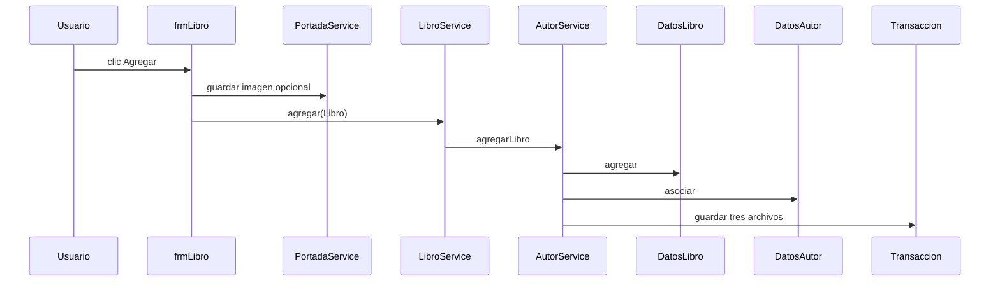
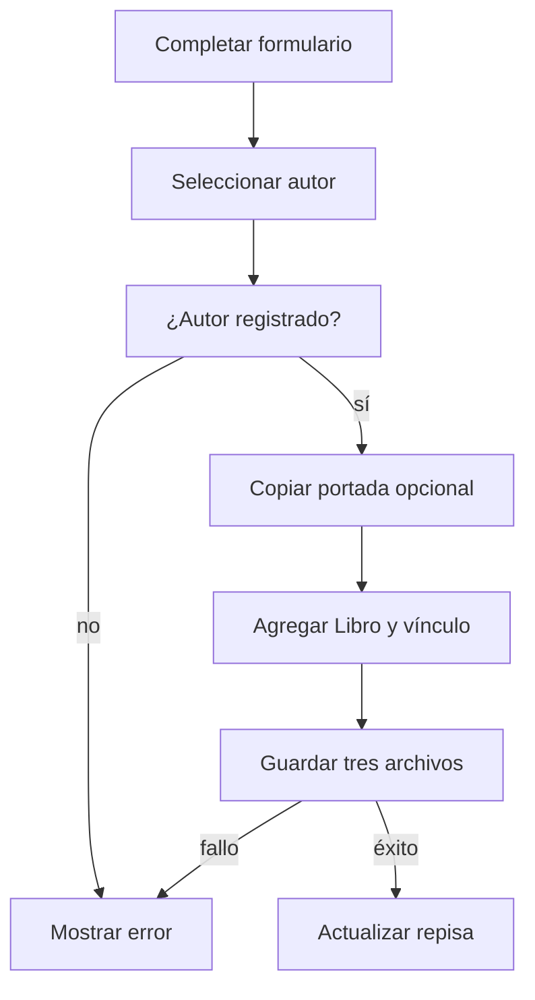

# Gestión de libros y portadas

## A. Perspectiva de negocio

Desde Mantenimiento → Libro se registra, busca, edita o elimina un libro. Se introduce título, autor registrado, ISBN, categoría, año, cantidades y portada opcional.

El autor debe existir; el servicio conserva la relación autor-libro. La portada seleccionada se copia a imágenes con un nombre que evita sobrescribir otra portada.

## B. Perspectiva técnica

frmLibro construye Libro y, si se eligió imagen, llama PortadaService.guardar. LibroService delega alta, edición y baja a AutorService para coordinar el catálogo y el vínculo.

AutorService resuelve el autor por nombre, actualiza DatosLibro y DatosAutor, y guarda libros.txt, autores.txt y libroAutor.txt juntos. DatosLibro.buscar filtra título o autor.

## C. Diagrama de secuencia



## D. Diagrama de flujo



## E. Código Java explicado

### `forms.frmLibro.actionPerformedBtnAgregar`

**Firma:** `protected void actionPerformedBtnAgregar(ActionEvent e) {`  
**Fuente:** [Biblioteca/src/forms/frmLibro.java:281](../../Biblioteca/src/forms/frmLibro.java#L281)  
**Por qué participa:** Recoge el formulario y crea Libro.  
**Invocado por:** JButton Agregar  
**Invoca después:** guardarImagen, LibroService.agregar

```java
	protected void actionPerformedBtnAgregar(ActionEvent e) {

		Categoria categoria = (Categoria) cbxCategoria.getSelectedItem();

		try {
			String titulo = txtTitulo.getText();
			Autor autorSeleccionado = (Autor) cbxAutor.getSelectedItem();
			if (autorSeleccionado == null) throw new IllegalArgumentException("Seleccione un autor registrado");
			String autor = autorSeleccionado.getNombre();
			String isbn = txtIsbn.getText();
			int publicacion = Integer.parseInt(txtAnioPublicacion.getText());
			String codCategoria = categoria.getCodCategoria();
```

### `forms.frmLibro.guardarImagen`

**Firma:** `public boolean guardarImagen() {`  
**Fuente:** [Biblioteca/src/forms/frmLibro.java:464](../../Biblioteca/src/forms/frmLibro.java#L464)  
**Por qué participa:** Copia portada si se eligió un archivo.  
**Invocado por:** frmLibro.actionPerformedBtnAgregar/Actualizar  
**Invoca después:** PortadaService.guardar

```java
public boolean guardarImagen() {
		File archivo = fileChooser.getSelectedFile();
		if (archivo == null) return true;
		try {
			rutaPortada = portadaService.guardar(archivo.toPath());
			return true;
		} catch (IOException error) {
			JOptionPane.showMessageDialog(this, "No se pudo guardar la imagen: " + error.getMessage(),
					"Error", JOptionPane.ERROR_MESSAGE);
			return false;
		}
	}
```

### `service.PortadaService.guardar`

**Firma:** `public String guardar(Path origen) throws IOException {`  
**Fuente:** [Biblioteca/src/service/PortadaService.java:10](../../Biblioteca/src/service/PortadaService.java#L10)  
**Por qué participa:** Evita colisión de nombre de imagen.  
**Invocado por:** frmLibro.guardarImagen  
**Invoca después:** Files.copy

```java
    public String guardar(Path origen) throws IOException {
        Path carpeta = Rutas.raiz().resolve("imagenes").resolve("portadas");
        Files.createDirectories(carpeta);
        Path destino = carpeta.resolve(origen.getFileName());
        if (!origen.toAbsolutePath().normalize().equals(destino.toAbsolutePath().normalize())) {
            String nombre = origen.getFileName().toString();
            int punto = nombre.lastIndexOf('.');
            String base = punto < 0 ? nombre : nombre.substring(0, punto);
            String extension = punto < 0 ? "" : nombre.substring(punto);
            int indice = 1;
            while (Files.exists(destino)) destino = carpeta.resolve(base + "_" + indice++ + extension);
            Files.copy(origen, destino);
```

### `service.LibroService.agregar`

**Firma:** `public String agregar(Libro libro) {`  
**Fuente:** [Biblioteca/src/service/LibroService.java:15](../../Biblioteca/src/service/LibroService.java#L15)  
**Por qué participa:** Delega el alta coordinada.  
**Invocado por:** frmLibro.actionPerformedBtnAgregar  
**Invoca después:** AutorService.agregarLibro

```java
    public String agregar(Libro libro) {
        autores.agregarLibro(libro); return "Libro agregado";
    }
```

### `service.AutorService.agregarLibro`

**Firma:** `public void agregarLibro(Libro libro) {`  
**Fuente:** [Biblioteca/src/service/AutorService.java:65](../../Biblioteca/src/service/AutorService.java#L65)  
**Por qué participa:** Asocia el libro al autor registrado.  
**Invocado por:** LibroService.agregar  
**Invoca después:** DatosLibro.agregar, DatosAutor.asociar, cambiar

```java
    public void agregarLibro(Libro libro) {
        Autor autor = autorSeleccionado(libro);
        cambiar(() -> {
            libro.setAutor(autor.getNombre());
            libros.agregar(libro);
            datos.asociar(libro.getCodLibro(), autor.getCodigo());
        });
    }
```

### `colecciones.DatosLibro.buscar`

**Firma:** `public ArrayList<Libro> buscar(String busqueda) {`  
**Fuente:** [Biblioteca/src/colecciones/DatosLibro.java:72](../../Biblioteca/src/colecciones/DatosLibro.java#L72)  
**Por qué participa:** Filtra título o autor en memoria.  
**Invocado por:** LibroService.buscar  
**Invoca después:** ArrayList

```java
	public ArrayList<Libro> buscar(String busqueda) {

		libroAgregado.clear();

		Libro l = new Libro();

		busqueda = quitarTildes(busqueda).toLowerCase();

		for (int i = 0; i < longitud(); i++) {
			l = obtener(i);

			if (quitarTildes(l.getTitulo().toLowerCase()).contains(busqueda)
```

### `repository.Formatos.escribirLibro`

**Firma:** `public static String escribirLibro(Libro x) {`  
**Fuente:** [Biblioteca/src/repository/Formatos.java:27](../../Biblioteca/src/repository/Formatos.java#L27)  
**Por qué participa:** Serializa las nueve columnas.  
**Invocado por:** ArchivoTextoRepository.guardar  
**Invoca después:** getters de Libro

```java
    public static String escribirLibro(Libro x) {
        return String.join(";", x.getCodLibro(), x.getTitulo(), x.getAutor(), x.getIsnb(),
                x.getCodCategoria(), String.valueOf(x.getAnioPublicacion()),
                String.valueOf(x.getCantidadDisponible()), String.valueOf(x.getCantidadTotal()), x.getRutaPortada());
    }
```

## F. Datos y persistencia

Libro usa codLibro L* y codCategoria C*. libros.txt conserva nueve campos: código;título;autor;ISBN;categoría;año;disponible;total;rutaPortada.

La imagen se copia antes de guardar el libro; si un guardado posterior falla, el código actual no revierte esa imagen copiada. Las rutas relativas se resuelven con Rutas.imagen.

## G. Depuración en IntelliJ

Breakpoint en frmLibro.actionPerformedBtnAgregar. Step Into en guardarImagen y PortadaService.guardar si hay archivo seleccionado; después LibroService.agregar y AutorService.agregarLibro.

Inspecciona cbxAutor, Libro.codLibro antes/después, rutaPortada, DatosAutor.relaciones y los tres archivos. Para búsqueda entra en DatosLibro.buscar.

## H. Pruebas

PruebasBiblioteca.main cubre CRUD de libros y copia de portadas; probarAutores comprueba el vínculo de un libro nuevo. Quedan pendientes la inspección visual de miniaturas y selección de autor en IntelliJ.

[Volver al explorador](../explorador/index.html)
