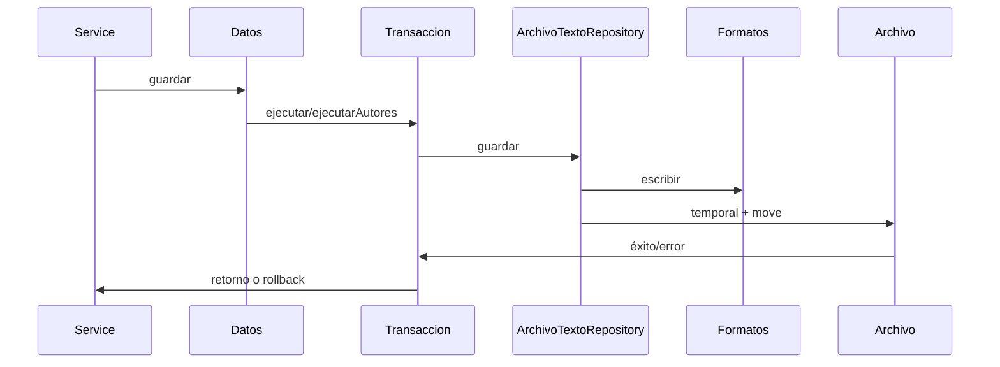
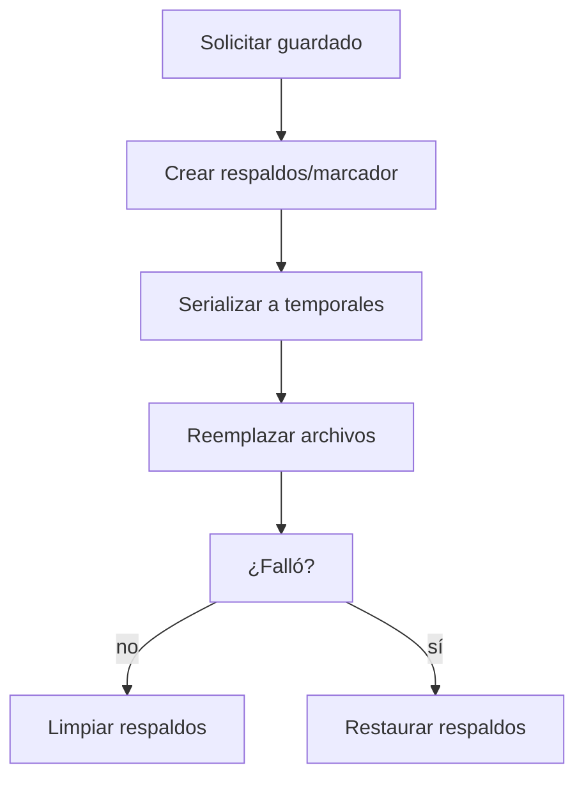

# Persistencia y recuperación

## A. Perspectiva de negocio

El sistema conserva las colecciones en archivos de texto. Un fallo de escritura debe evitar que un préstamo o una relación autor-libro queden a medias.

Al iniciar, una transacción pendiente se intenta recuperar antes de mostrar la interfaz. Un registro mal formado detiene la carga en lugar de sobrescribirlo.

## B. Perspectiva técnica

ArchivoTextoRepository.cargar lee UTF-8 y aplica Formatos.leer*. guardar serializa todas las filas a un temporal y lo mueve al destino. Rutas.dato resuelve la carpeta de datos.

TransaccionArchivos.ejecutar coordina préstamos, detalles y libros. ejecutarAutores coordina autores, relaciones y libros, admite archivos nuevos y usa .autores-pendiente. recuperarPendiente revisa ambos mecanismos.

## C. Diagrama de secuencia



## D. Diagrama de flujo



## E. Código Java explicado

### `util.Rutas.raiz`

**Firma:** `public static Path raiz() {`  
**Fuente:** [Biblioteca/src/util/Rutas.java:10](../../Biblioteca/src/util/Rutas.java#L10)  
**Por qué participa:** Ubica Biblioteca/datos.  
**Invocado por:** Rutas.dato  
**Invoca después:** System.getProperty, Files.isDirectory

```java
    public static Path raiz() {
        String configurada = System.getProperty("biblioteca.home");
        if (configurada != null && !configurada.isBlank()) {
            Path raiz = Path.of(configurada).toAbsolutePath().normalize();
            if (!Files.isDirectory(raiz.resolve("datos"))) {
                throw new IllegalStateException("No existe la carpeta datos en " + raiz);
            }
            return raiz;
        }
        Path actual = Path.of("").toAbsolutePath().normalize();
        for (Path carpeta = actual; carpeta != null; carpeta = carpeta.getParent()) {
            if (Files.isDirectory(carpeta.resolve("datos"))) return carpeta;
```

### `repository.ArchivoTextoRepository.cargar`

**Firma:** `public ArrayList<T> cargar() {`  
**Fuente:** [Biblioteca/src/repository/ArchivoTextoRepository.java:25](../../Biblioteca/src/repository/ArchivoTextoRepository.java#L25)  
**Por qué participa:** Lee y parsea líneas UTF-8.  
**Invocado por:** Datos*.recuperar  
**Invoca después:** Formatos.leer*

```java
    public ArrayList<T> cargar() {
        ArrayList<T> resultado = new ArrayList<>();
        try {
            int numero = 0;
            for (String linea : Files.readAllLines(archivo, StandardCharsets.UTF_8)) {
                numero++;
                try { resultado.add(leer.apply(linea)); }
                catch (RuntimeException error) {
                    throw new IllegalStateException("Registro inválido en " + archivo + ", línea " + numero, error);
                }
            }
            return resultado;
```

### `repository.ArchivoTextoRepository.guardar`

**Firma:** `public void guardar(ArrayList<T> registros) {`  
**Fuente:** [Biblioteca/src/repository/ArchivoTextoRepository.java:43](../../Biblioteca/src/repository/ArchivoTextoRepository.java#L43)  
**Por qué participa:** Escribe temporal y reemplaza destino.  
**Invocado por:** Datos*.guardar  
**Invoca después:** Formatos.escribir*, Files.move

```java
    public void guardar(ArrayList<T> registros) {
        Path temporal = null;
        try {
            ArrayList<String> lineas = new ArrayList<>();
            for (T registro : registros) lineas.add(escribir.apply(registro));
            temporal = Files.createTempFile(archivo.getParent(), archivo.getFileName().toString(), ".tmp");
            Files.write(temporal, lineas, StandardCharsets.UTF_8);
            try {
                Files.move(temporal, archivo, StandardCopyOption.ATOMIC_MOVE, StandardCopyOption.REPLACE_EXISTING);
            } catch (AtomicMoveNotSupportedException error) {
                Files.move(temporal, archivo, StandardCopyOption.REPLACE_EXISTING);
            }
```

### `repository.Formatos.campos`

**Firma:** `private static String[] campos(String linea, int cantidad) {`  
**Fuente:** [Biblioteca/src/repository/Formatos.java:16](../../Biblioteca/src/repository/Formatos.java#L16)  
**Por qué participa:** Comprueba número de columnas.  
**Invocado por:** Formatos.leer*  
**Invoca después:** String.split

```java
    private static String[] campos(String linea, int cantidad) {
        String[] partes = linea.split(";", -1);
        if (partes.length != cantidad) throw new IllegalArgumentException("Se esperaban " + cantidad + " campos");
        return partes;
    }
```

### `repository.TransaccionArchivos.ejecutar`

**Firma:** `public static void ejecutar(Runnable operacion, String... nombres) {`  
**Fuente:** [Biblioteca/src/repository/TransaccionArchivos.java:99](../../Biblioteca/src/repository/TransaccionArchivos.java#L99)  
**Por qué participa:** Coordina tres archivos de préstamo.  
**Invocado por:** PrestamoService.registrar  
**Invoca después:** respaldos, marcador

```java
    public static void ejecutar(Runnable operacion, String... nombres) {
        ArrayList<byte[]> originales = new ArrayList<>();
        ArrayList<Path> rutas = new ArrayList<>();
        Path marcador = Rutas.dato(MARCADOR);
        try {
            for (String nombre : nombres) {
                Path ruta = Rutas.dato(nombre);
                rutas.add(ruta);
                originales.add(Files.readAllBytes(ruta));
            }
            for (int i = 0; i < rutas.size(); i++) {
                Files.write(Rutas.dato(nombres[i] + ".prestamo.bak"), originales.get(i));
```

### `repository.TransaccionArchivos.ejecutarAutores`

**Firma:** `public static void ejecutarAutores(Runnable operacion, String... nombres) {`  
**Fuente:** [Biblioteca/src/repository/TransaccionArchivos.java:40](../../Biblioteca/src/repository/TransaccionArchivos.java#L40)  
**Por qué participa:** Coordina autores y libros.  
**Invocado por:** AutorService.cambiar  
**Invoca después:** respaldos, marcador

```java
    public static void ejecutarAutores(Runnable operacion, String... nombres) {
        Path marcador = Rutas.dato(".autores-pendiente");
        if (Files.exists(marcador)) throw new IllegalStateException("Existe una operación de autores pendiente");
        ArrayList<String> estado = new ArrayList<>();
        try {
            for (String nombre : nombres) {
                Path archivo = Rutas.dato(nombre);
                boolean existe = Files.exists(archivo);
                estado.add(nombre + ";" + existe);
                if (existe) Files.copy(archivo, Rutas.dato(nombre + ".autores.bak"), StandardCopyOption.REPLACE_EXISTING);
                else Files.deleteIfExists(Rutas.dato(nombre + ".autores.bak"));
            }
```

### `repository.TransaccionArchivos.recuperarPendiente`

**Firma:** `public static void recuperarPendiente() {`  
**Fuente:** [Biblioteca/src/repository/TransaccionArchivos.java:19](../../Biblioteca/src/repository/TransaccionArchivos.java#L19)  
**Por qué participa:** Recupera antes de cargar.  
**Invocado por:** BibliotecaContexto  
**Invoca después:** recuperarAutores, Files.copy

```java
    public static void recuperarPendiente() {
        recuperarAutores();
        Path marcador = Rutas.dato(MARCADOR);
        if (!Files.exists(marcador)) return;
        try {
            for (String nombre : ARCHIVOS) {
                Path respaldo = Rutas.dato(nombre + ".prestamo.bak");
                if (!Files.exists(respaldo)) throw new IOException("Falta respaldo de " + nombre);
            }
            for (String nombre : ARCHIVOS) {
                Files.copy(Rutas.dato(nombre + ".prestamo.bak"), Rutas.dato(nombre),
                        StandardCopyOption.REPLACE_EXISTING);
```

## F. Datos y persistencia

Separador real: ;. Formatos exige 9/6/4/4/2/2/2 campos según entidad y parsea números y fechas. No se añade estado de préstamo a prestamos.txt.

La sustitución individual es atómica si el sistema de archivos lo permite; las operaciones de varios archivos emplean respaldos y marcadores. Portadas son archivos de imagen separados, fuera de estas transacciones.

## G. Depuración en IntelliJ

Breakpoint en ArchivoTextoRepository.guardar para una escritura y en TransaccionArchivos.ejecutar o ejecutarAutores para varias.

Inspecciona archivo, lineas, temporal, marcador, respaldos y excepciones suprimidas. Para un arranque tras interrupción sigue recuperarPendiente antes de los constructores Datos*.

## H. Pruebas

PruebasBiblioteca.main y probarAutores simulan fallos de archivo, marcador pendiente, datos corruptos y recarga. La recuperación frente a un apagado físico real no se ha ensayado.

[Volver al explorador](../explorador/index.html)
