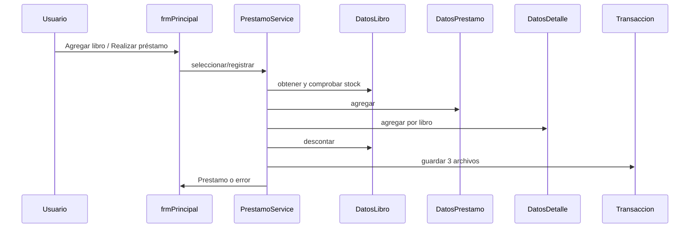
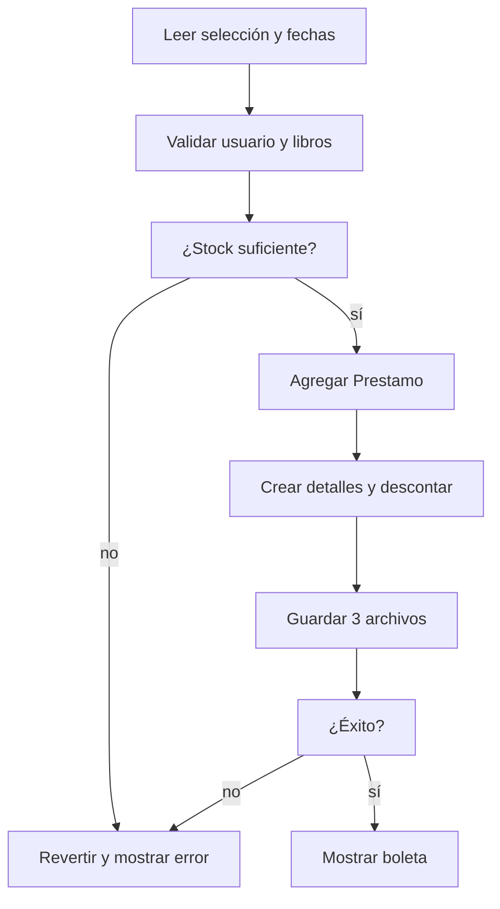

# Selección y registro de préstamos

## A. Perspectiva de negocio

En la ventana principal se selecciona un usuario, uno o varios libros y las fechas. Cada clic en Agregar aumenta una unidad del libro seleccionado; Quitar reduce una unidad.

Al realizar el préstamo se exige usuario, al menos un libro y existencias suficientes por título. Se crea el préstamo, se registra cada cantidad y se descuenta del inventario. No hay devolución implementada.

## B. Perspectiva técnica

frmPrincipal recibe eventos de TarjetasLibro y mantiene la selección mediante PrestamoService → DatosLibroDetalle. Al confirmar, convierte fechas dd/MM/yyyy a LocalDate y llama registrar.

PrestamoService valida, añade Prestamo a DatosPrestamo, crea DetallePrestamo por cada libro, descuenta stock y guarda préstamos, detalles y libros mediante TransaccionArchivos.ejecutar. Si falla, revierte las mutaciones en memoria.

## C. Diagrama de secuencia



## D. Diagrama de flujo



## E. Código Java explicado

### `forms.frmPrincipal.agregarLibro`

**Firma:** `public void agregarLibro(Libro l) {`  
**Fuente:** [Biblioteca/src/forms/frmPrincipal.java:263](../../Biblioteca/src/forms/frmPrincipal.java#L263)  
**Por qué participa:** Recibe clic de tarjeta.  
**Invocado por:** TarjetasLibro.catalogo  
**Invoca después:** PrestamoService.seleccionar

```java
	public void agregarLibro(Libro l) {
		contexto.prestamos().seleccionar(l);
		actualizarPanelAgregados();
	}
```

### `util.DatosLibroDetalle.actualizarLista`

**Firma:** `public void actualizarLista(Libro l) {`  
**Fuente:** [Biblioteca/src/util/DatosLibroDetalle.java:29](../../Biblioteca/src/util/DatosLibroDetalle.java#L29)  
**Por qué participa:** Agrupa por codLibro y aumenta cantidad.  
**Invocado por:** PrestamoService.seleccionar  
**Invoca después:** DetalleLibro.setCantidad

```java
	public void actualizarLista(Libro l) {

		for (int i = 0; i < longitud(); i++) {
			DetalleLibro dl = obtener(i);

			if (dl.getLibro().getCodLibro().equals(l.getCodLibro())) {
				dl.setCantidad(dl.getCantidad() + 1);
				return;
			}
		}

		agregar(l);
```

### `forms.frmPrincipal.actionPerformedBtnEjecutarPrestamo`

**Firma:** `protected void actionPerformedBtnEjecutarPrestamo(ActionEvent e) {`  
**Fuente:** [Biblioteca/src/forms/frmPrincipal.java:333](../../Biblioteca/src/forms/frmPrincipal.java#L333)  
**Por qué participa:** Lee usuario/fechas y solicita registro.  
**Invocado por:** JButton Realizar préstamo  
**Invoca después:** PrestamoService.registrar, frmBoleta

```java
	protected void actionPerformedBtnEjecutarPrestamo(ActionEvent e) {

		try {

			Usuario codUsuario = (Usuario) cbxUsuario.getSelectedItem();

			String fechaPrest = txtFechaPrestamo.getText();
			String fechaDev = txtFechaDevolucion.getText();

			DateTimeFormatter formatter = DateTimeFormatter.ofPattern("dd/MM/yyyy");

			LocalDate fechaPrestamo = LocalDate.parse(fechaPrest, formatter);
```

### `service.PrestamoService.registrar`

**Firma:** `public Prestamo registrar(Usuario usuario, LocalDate fecha, LocalDate devolucion) {`  
**Fuente:** [Biblioteca/src/service/PrestamoService.java:48](../../Biblioteca/src/service/PrestamoService.java#L48)  
**Por qué participa:** Valida, crea detalles, descuenta y persiste.  
**Invocado por:** frmPrincipal.actionPerformedBtnEjecutarPrestamo  
**Invoca después:** DatosPrestamo.agregar, DatosDetallePrestamo.agregar, TransaccionArchivos.ejecutar

```java
    public Prestamo registrar(Usuario usuario, LocalDate fecha, LocalDate devolucion) {
        if (usuario == null) throw new IllegalArgumentException("Seleccione un usuario");
        if (seleccion.longitud() == 0) throw new IllegalArgumentException("Seleccione al menos un libro");
        for (DetalleLibro elegido : seleccion.listar()) {
            Libro libro = libros.obtenerPorCodigo(elegido.getLibro().getCodLibro());
            if (libro == null) throw new IllegalArgumentException("El libro seleccionado ya no existe");
            if (elegido.getCantidad() <= 0 || elegido.getCantidad() > libro.getCantidadDisponible()) {
                throw new IllegalArgumentException("No hay ejemplares disponibles de " + libro.getTitulo());
            }
        }

        Prestamo prestamo = new Prestamo(usuario.getCodUser(), fecha, devolucion);
```

### `repository.TransaccionArchivos.ejecutar`

**Firma:** `public static void ejecutar(Runnable operacion, String... nombres) {`  
**Fuente:** [Biblioteca/src/repository/TransaccionArchivos.java:99](../../Biblioteca/src/repository/TransaccionArchivos.java#L99)  
**Por qué participa:** Respalda tres archivos y revierte fallos.  
**Invocado por:** PrestamoService.registrar  
**Invoca después:** Runnable de guardar

```java
    public static void ejecutar(Runnable operacion, String... nombres) {
        ArrayList<byte[]> originales = new ArrayList<>();
        ArrayList<Path> rutas = new ArrayList<>();
        Path marcador = Rutas.dato(MARCADOR);
        try {
            for (String nombre : nombres) {
                Path ruta = Rutas.dato(nombre);
                rutas.add(ruta);
                originales.add(Files.readAllBytes(ruta));
            }
            for (int i = 0; i < rutas.size(); i++) {
                Files.write(Rutas.dato(nombres[i] + ".prestamo.bak"), originales.get(i));
```

## F. Datos y persistencia

Selección temporal: ArrayList<DetalleLibro> con Libro y cantidad. Persistencia: prestamos.txt código;usuario;fechaPréstamo;fechaDevolución; detallePrestamo.txt códigoDetalle;códigoPréstamo;códigoLibro;cantidad; libros.txt stock disponible.

Los códigos son String; fechas persistidas como ISO LocalDate. Los archivos históricos no se reparan por el registro de un préstamo nuevo.

## G. Depuración en IntelliJ

Empieza en frmPrincipal.agregarLibro para la selección y luego en actionPerformedBtnEjecutarPrestamo para confirmar.

Step Into en PrestamoService.registrar. Inspecciona seleccion.listar(), libro.cantidadDisponible, nuevosDetalles, descontados y codPrestamo. Step Over en cada guardado para identificar qué archivo se escribe.

## H. Pruebas

PruebasBiblioteca.main rechaza falta de stock y registra un préstamo; probarPrestamoMultiple cubre dos libros, cantidades 2 y 3 y fallo durante el segundo libro.

[Volver al explorador](../explorador/index.html)
