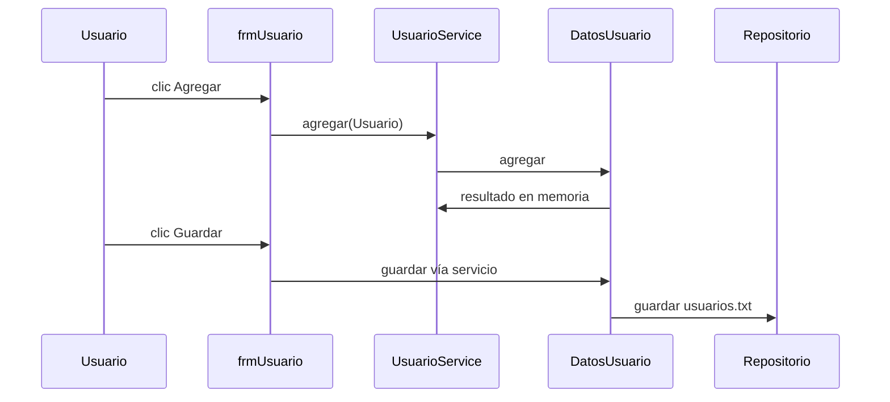
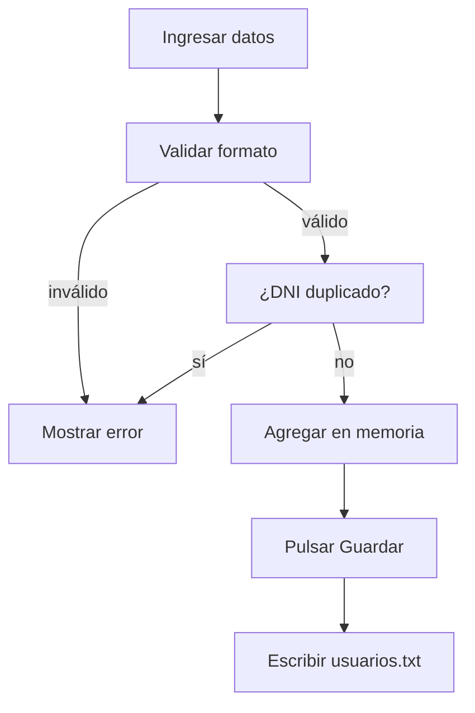

# Gestión de usuarios

## A. Perspectiva de negocio

Desde Mantenimiento → Usuario se registran, buscan, modifican y eliminan lectores. Se introducen nombre, DNI, correo, teléfono y estado.

El servicio valida campos y formatos; DatosUsuario evita DNI duplicado. Solo se elimina un usuario en estado Registrado. Agregar, modificar y eliminar cambian memoria; el botón Guardar escribe usuarios.txt.

## B. Perspectiva técnica

frmUsuario recibe UsuarioService de BibliotecaContexto. Los botones llaman a agregar, actualizar, eliminar o guardar. El formulario captura errores de validación y actualiza la tabla y el selector de la ventana principal.

UsuarioService valida; DatosUsuario asigna código U*, consulta ArrayList y delega guardar al repositorio. La búsqueda por código o DNI recorre la colección.

## C. Diagrama de secuencia



## D. Diagrama de flujo



## E. Código Java explicado

### `forms.frmUsuario.actionPerformedBtnAgregar`

**Firma:** `protected void actionPerformedBtnAgregar(ActionEvent e) {`  
**Fuente:** [Biblioteca/src/forms/frmUsuario.java:232](../../Biblioteca/src/forms/frmUsuario.java#L232)  
**Por qué participa:** Construye Usuario desde el formulario.  
**Invocado por:** JButton Agregar  
**Invoca después:** UsuarioService.agregar

```java
protected void actionPerformedBtnAgregar(ActionEvent e) {
		Usuario usuario = new Usuario(txtNombres.getText().trim(), txtDni.getText().trim(),
				txtEmail.getText().trim(), txtFono.getText().trim(), (String) cboEstado.getSelectedItem());
		try {
			String mensaje = usuarios.agregar(usuario);
			JOptionPane.showMessageDialog(this, mensaje);
			cargarUsuario();
			actualizarUsuarios.run();
		} catch (IllegalArgumentException error) {
			JOptionPane.showMessageDialog(this, error.getMessage(), "Error de validación", JOptionPane.ERROR_MESSAGE);
		}
	}
```

### `service.UsuarioService.agregar`

**Firma:** `public String agregar(Usuario usuario) {`  
**Fuente:** [Biblioteca/src/service/UsuarioService.java:18](../../Biblioteca/src/service/UsuarioService.java#L18)  
**Por qué participa:** Valida antes de delegar.  
**Invocado por:** frmUsuario.actionPerformedBtnAgregar  
**Invoca después:** validar, DatosUsuario.agregar

```java
    public String agregar(Usuario usuario) {
        validar(usuario, true);
        return datos.agregar(usuario);
    }
```

### `service.UsuarioService.validar`

**Firma:** `private void validar(Usuario usuario, boolean alta) {`  
**Fuente:** [Biblioteca/src/service/UsuarioService.java:39](../../Biblioteca/src/service/UsuarioService.java#L39)  
**Por qué participa:** Comprueba campos y formatos.  
**Invocado por:** UsuarioService.agregar/actualizar  
**Invoca después:** IllegalArgumentException

```java
    private void validar(Usuario usuario, boolean alta) {
        String nombre = usuario.getNomUser().trim();
        String dni = usuario.getDniUser().trim();
        String telefono = usuario.getFonoUser().trim();
        String correo = usuario.getEmailUser().trim();
        String estado = usuario.getEstadoUser();
        if (nombre.isEmpty() || dni.isEmpty() || telefono.isEmpty() || (alta && correo.isEmpty()))
            throw new IllegalArgumentException("Debe completar todos los campos.");
        if (!nombre.matches("^[\\p{L}\\s]+$"))
            throw new IllegalArgumentException("El nombre solo debe contener letras y espacios.");
        if (alta && !correo.matches("^[\\w.-]+@[\\w.-]+\\.[a-zA-Z]{2,}$"))
            throw new IllegalArgumentException("Ingrese un correo electrónico válido.");
```

### `colecciones.DatosUsuario.agregar`

**Firma:** `public String agregar(Usuario reg) {`  
**Fuente:** [Biblioteca/src/colecciones/DatosUsuario.java:43](../../Biblioteca/src/colecciones/DatosUsuario.java#L43)  
**Por qué participa:** Comprueba DNI y asigna código.  
**Invocado por:** UsuarioService.agregar  
**Invoca después:** asignarCodigo, ArrayList.add

```java
	public String agregar(Usuario reg) {
		// Recorremos la lista para verificar si el DNI ya existe
	    for (Usuario u : usuarios) {
	        if (u.getDniUser().equals(reg.getDniUser())) {
	            return "El DNI " + reg.getDniUser() + " ya se encuentra registrado.";
	        }
	    }
	    //si no existe lo agregamos de manera normal
		asignarCodigo(reg);
		usuarios.add(reg);
		return "Registro del Usuario Agregado";
	}
```

### `forms.frmUsuario.actionPerformedBtnGuardar`

**Firma:** `protected void actionPerformedBtnGuardar(ActionEvent e) {`  
**Fuente:** [Biblioteca/src/forms/frmUsuario.java:328](../../Biblioteca/src/forms/frmUsuario.java#L328)  
**Por qué participa:** Inicia persistencia explícita.  
**Invocado por:** JButton Guardar  
**Invoca después:** UsuarioService.guardar

```java
	protected void actionPerformedBtnGuardar(ActionEvent e) {
		
		String mensaje=usuarios.guardar();
		JOptionPane.showMessageDialog(null, mensaje);
		
		
	}
```

### `colecciones.DatosUsuario.guardar`

**Firma:** `public String guardar() {`  
**Fuente:** [Biblioteca/src/colecciones/DatosUsuario.java:90](../../Biblioteca/src/colecciones/DatosUsuario.java#L90)  
**Por qué participa:** Envía copia de la lista al repositorio.  
**Invocado por:** UsuarioService.guardar  
**Invoca después:** Repositorio.guardar

```java
	public String guardar() {
		repositorio.guardar(new ArrayList<>(usuarios));
		return "Se han guardado " + usuarios.size() + " registros de usuarios";
	}
```

### `repository.Formatos.escribirUsuario`

**Firma:** `public static String escribirUsuario(Usuario x) {`  
**Fuente:** [Biblioteca/src/repository/Formatos.java:39](../../Biblioteca/src/repository/Formatos.java#L39)  
**Por qué participa:** Serializa seis campos.  
**Invocado por:** ArchivoTextoRepository.guardar  
**Invoca después:** getters de Usuario

```java
    public static String escribirUsuario(Usuario x) {
        return String.join(";", x.getCodUser(), x.getNomUser(), x.getDniUser(), x.getEmailUser(), x.getFonoUser(), x.getEstadoUser());
    }
```

## F. Datos y persistencia

Usuario usa codUser String. usuarios.txt: código;nombre;DNI;correo;teléfono;estado. Los cambios pendientes en memoria pueden perderse si se cierra sin pulsar Guardar.

Formato real: Formatos.leerUsuario/escribirUsuario. El archivo se lee en DatosUsuario.recuperar y se escribe en DatosUsuario.guardar.

## G. Depuración en IntelliJ

Breakpoint inicial en frmUsuario.actionPerformedBtnAgregar; para edición/eliminación usa actionPerformedBtnModificar o actionPerformedBtnEliminar.

Sigue UsuarioService.validar, DatosUsuario.agregar/actualizar/eliminar y, al pulsar Guardar, ArchivoTextoRepository.guardar. Inspecciona DNI, estado, codUser y longitud del ArrayList antes y después.

## H. Pruebas

PruebasBiblioteca.main registra, actualiza, guarda, recarga y elimina un usuario sobre copias temporales. La tabla, mensajes y necesidad de pulsar Guardar se verifican manualmente.

[Volver al explorador](../explorador/index.html)
