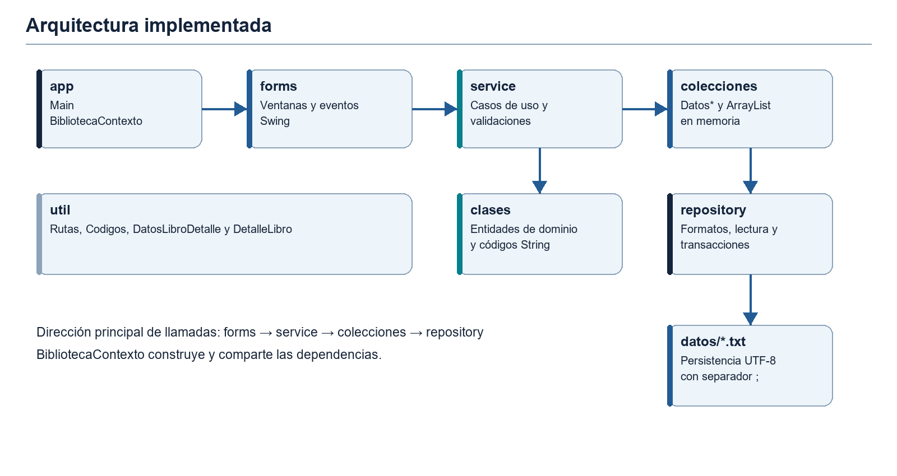
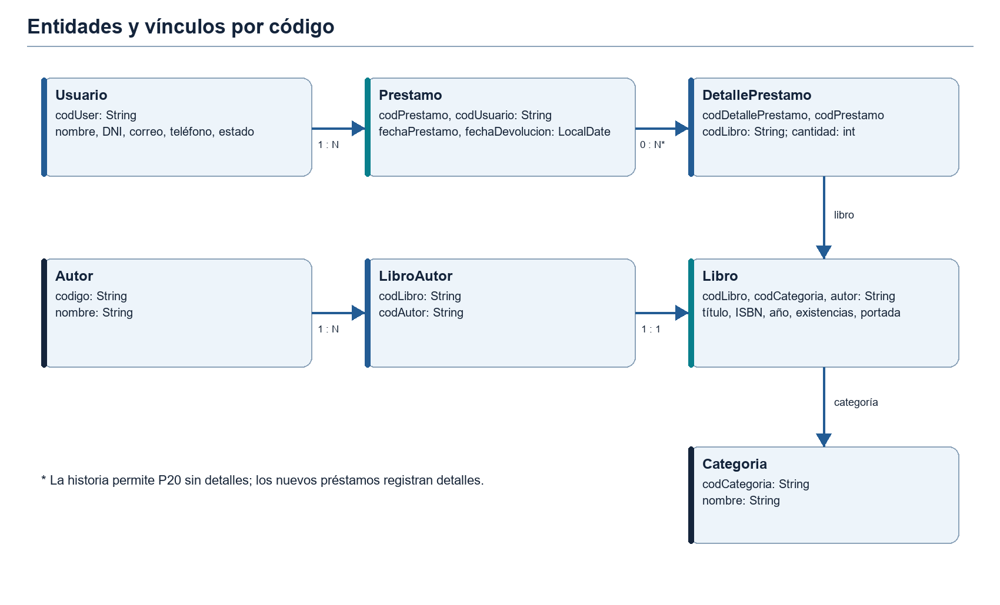
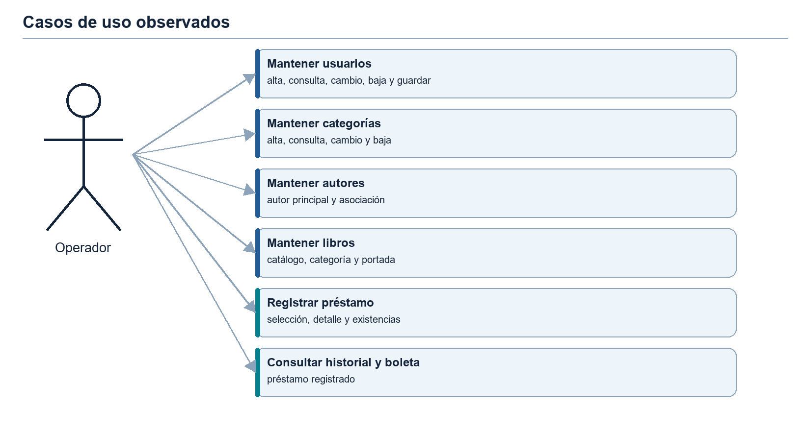
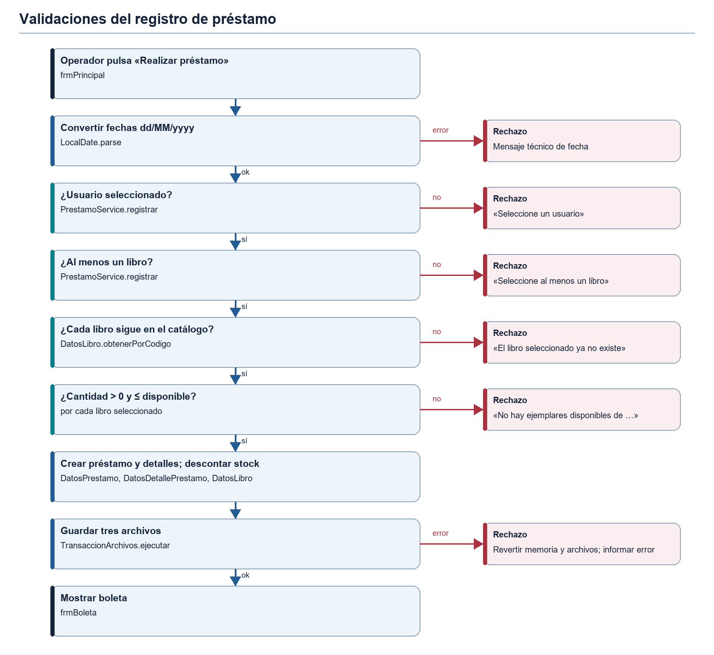
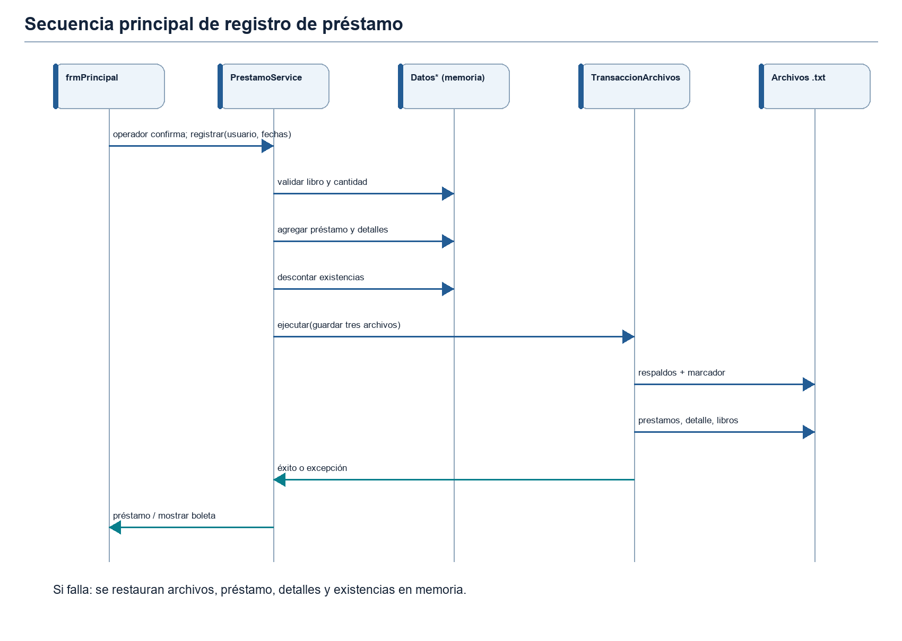
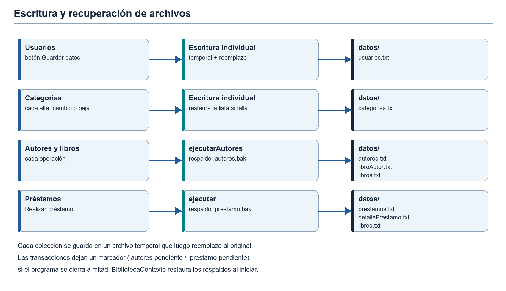

# Informe integral de AppBiblioteca

**Borrador académico para revisión grupal — CIBERTEC**  
**Programa o carrera:** PENDIENTE DE COMPLETAR  
**Curso y sección:** PENDIENTE DE COMPLETAR  
**Docente:** PENDIENTE DE COMPLETAR  
**Integrantes y coordinador:** PENDIENTE DE COMPLETAR  
**Sede y fecha de entrega:** PENDIENTE DE COMPLETAR  
**Versión analizada:** rama `feature/CIB-001`, código disponible en el repositorio al elaborar este borrador.  
**Fecha de elaboración del borrador:** 18/10/2026.

> **Criterio de evidencia.** Este informe describe el código ejecutable actual. Los documentos iniciales y el informe preliminar sirven para reconstruir la motivación académica; sus propuestas que no aparecen en el código se indican como pendientes. Los ejemplos de registros son ilustrativos y no reproducen datos personales reales. Las observaciones marcadas como «por revisión de código» se dedujeron leyendo la implementación y no se reprodujeron en la interfaz.

## Índice

1. [Capítulo I. Generalidades](#capítulo-i-generalidades)
2. [Capítulo II. Análisis funcional y de negocio](#capítulo-ii-análisis-funcional-y-de-negocio)
3. [Capítulo III. Tecnologías y arquitectura](#capítulo-iii-tecnologías-y-arquitectura)
4. [Capítulo IV. Diseño del sistema](#capítulo-iv-diseño-del-sistema)
5. [Capítulo V. Implementación funcional y técnica](#capítulo-v-implementación-funcional-y-técnica)
6. [Capítulo VI. Persistencia e integridad](#capítulo-vi-persistencia-e-integridad)
7. [Capítulo VII. Validaciones, control de existencias y manejo de errores](#capítulo-vii-validaciones-control-de-existencias-y-manejo-de-errores)
8. [Capítulo VIII. Pruebas y validación](#capítulo-viii-pruebas-y-validación)
9. [Capítulo IX. Resultados, limitaciones, conclusiones y recomendaciones](#capítulo-ix-resultados-limitaciones-conclusiones-y-recomendaciones)
10. [Anexos](#anexos)

# Capítulo I. Generalidades

## 1.1 Introducción

AppBiblioteca es una aplicación de escritorio para administrar información bibliográfica y registrar préstamos de ejemplares. Reúne en una interfaz Swing los mantenimientos de usuarios, categorías, autores y libros, además de la selección de libros, el registro de préstamos, el historial y la consulta de boletas. Emplea Java 21, colecciones `ArrayList` en memoria y archivos de texto para conservar los registros entre ejecuciones. El sistema se estudia aquí como un proyecto académico de programación orientada a objetos y organización por capas, sin atribuirle funciones bibliotecarias que aún no existen.

El lector puede recorrer primero el problema y las operaciones visibles, después la estructura de clases y finalmente las reglas de persistencia, las validaciones y sus pruebas. Las referencias a archivos Java y líneas permiten contrastar cada afirmación técnica con la implementación. La documentación complementaria por flujos se encuentra en [`docs/flujos`](../flujos/) y el explorador local en [`docs/explorador/index.html`](../explorador/index.html).

## 1.2 Descripción del problema

En una biblioteca pequeña, registrar por separado los datos de lectores, libros y préstamos dificulta conocer los ejemplares disponibles y reconstruir qué libros se entregaron en una operación. Cuando el control se lleva en cuadernos u hojas sueltas, el operador debe revisar varias fuentes para responder preguntas básicas: si un título tiene ejemplares libres, a quién se prestó y en qué fecha debería volver. Los borradores académicos plantean reemplazar parte del registro manual por una aplicación local que centralice estos datos. Esa necesidad fundamenta el proyecto; no se dispone de una medición previa de tiempos, errores o pérdidas que permita cuantificar el problema.

## 1.3 Justificación

**Justificación operativa.** Desde la operación bibliotecaria, la utilidad esperada es consultar el catálogo con portadas, asociar cada libro a un autor principal, impedir que un préstamo exceda la disponibilidad y recuperar el historial guardado junto con su boleta. La aplicación sustituye la consulta de varias listas por una sola ventana con la estantería y el panel de préstamo.

**Justificación académica y técnica.** El sistema ofrece una práctica concreta de interfaces gráficas, clases, encapsulación, colecciones, excepciones y archivos. La refactorización hacia capas (`forms`, `service`, `colecciones`, `repository`) permite estudiar cómo se separan la presentación, las reglas y el almacenamiento, y cómo se protege la consistencia de varios archivos que cambian juntos.

**Justificación económica.** La solución usa solo la plataforma Java estándar y archivos locales, sin licencias de base de datos ni servidores. Esta afirmación se refiere al software empleado; no se estimaron costos de implantación.

## 1.4 Beneficiarios

*Tabla 1. Beneficiarios identificados*

| Beneficiario | Tipo | Beneficio esperado | Observación |
|---|---|---|---|
| Operador o encargado de biblioteca | Directo | Mantener catálogos y registrar préstamos desde una sola aplicación | Actor único de la aplicación; no hay inicio de sesión |
| Lectores (estudiantes, docentes u otros) | Indirecto | Información de disponibilidad más ordenada y una boleta del préstamo | Se registran como `Usuario`, pero no operan el sistema |
| Equipo de desarrollo | Académico | Práctica de POO, Swing, colecciones, persistencia y pruebas | Proyecto del curso |

La identificación de beneficiarios proviene del contexto de los documentos de proyecto; la aplicación no implementa autenticación ni perfiles diferenciados.

## 1.5 Objetivos

**Objetivo general.** Desarrollar y explicar una aplicación de escritorio para el mantenimiento de información de biblioteca y el registro consistente de préstamos, utilizando Java y persistencia local en texto.

**Objetivos específicos.**

- OE1. Mantener usuarios, categorías, autores y libros mediante formularios Swing.
- OE2. Representar una relación de un autor principal por libro, evitando autores duplicados.
- OE3. Seleccionar uno o más libros y registrar sus cantidades en un único préstamo.
- OE4. Validar la disponibilidad, actualizar existencias y conservar el préstamo junto con sus detalles.
- OE5. Ofrecer historial de préstamos y boleta de cada operación.
- OE6. Separar interfaz, servicios, colecciones y acceso a archivos.
- OE7. Comprobar reglas críticas mediante pruebas que trabajen sobre copias temporales de los datos.

El cumplimiento de cada objetivo se evalúa en la sección 9.1 y la trazabilidad completa aparece en el Anexo G.

## 1.6 Alcance

*Tabla 2. Alcance del proyecto*

| Incluido en esta versión | Fuera del alcance actual |
|---|---|
| Aplicación de escritorio local con Java 21 y Swing | Inicio de sesión, roles y permisos |
| Mantenimiento de usuarios, categorías, autores y libros | Base de datos SQL, red o acceso multiusuario |
| Portadas de libros copiadas a la carpeta del proyecto | Devolución de libros y reposición de existencias |
| Selección de varios libros con cantidades y registro de préstamo | Cambio de estado del préstamo o del usuario |
| Historial de préstamos y boleta en pantalla | Multas, reservas, renovaciones y reportes estadísticos |
| Persistencia en archivos `.txt` con recuperación ante fallos | Impresión o exportación de la boleta a PDF |
| Programa de pruebas sin dependencias externas | Pruebas automatizadas de la interfaz gráfica |

`fechaDevolucion` se guarda como fecha prevista; no ejecuta una devolución.

# Capítulo II. Análisis funcional y de negocio

## 2.1 Descripción general y actores

El operador abre la ventana principal, consulta la estantería, entra a los mantenimientos y registra préstamos. El sistema consulta los objetos cargados en memoria y escribe archivos locales en momentos distintos según el módulo. El lector de biblioteca figura como persona registrada en `Usuario`; no interactúa directamente con una cuenta o sesión. Para este informe, **operador** es el actor humano de los casos de uso y **sistema de archivos local** es un recurso técnico, no otro usuario.

## 2.2 Requerimientos funcionales verificados

*Tabla 3. Requerimientos funcionales*

| Código | Requerimiento observado | Evidencia principal | Estado |
|---|---|---|---|
| RF01 | Registrar, modificar y eliminar usuarios; guardar la lista en archivo | `frmUsuario`, `UsuarioService`, `DatosUsuario` | Implementado |
| RF02 | Buscar un usuario por código o DNI | `UsuarioService.buscar`, `DatosUsuario.buscarPorCodigoODni` | Implementado |
| RF03 | Registrar, buscar, modificar y eliminar categorías | `frmCategoria`, `CategoriaService` | Implementado |
| RF04 | Registrar, buscar, modificar y eliminar autores; impedir duplicados | `frmAutor`, `AutorService`, `DatosAutor` | Implementado |
| RF05 | Asociar a cada libro un autor principal registrado | `AutorService.agregarLibro`, `libroAutor.txt` | Implementado |
| RF06 | Mantener y buscar libros por título o autor; elegir categoría y portada | `frmLibro`, `LibroService`, `PortadaService` | Implementado |
| RF07 | Mostrar la estantería de libros con portada y búsqueda | `frmPrincipal.cargarRepisa`, `TarjetasLibro` | Implementado |
| RF08 | Seleccionar libros, acumular y quitar cantidades | `frmPrincipal`, `PrestamoService.seleccionar` | Implementado |
| RF09 | Registrar un préstamo con varios libros y descontar existencias | `PrestamoService.registrar` | Implementado |
| RF10 | Mostrar la boleta tras el préstamo y desde el historial | `frmBoleta`, `frmListaPrestamo` | Implementado |
| RF11 | Registrar devolución y cambiar el estado del préstamo | Sin caso de uso operativo en `PrestamoService` | Pendiente |
| RF12 | Imprimir o exportar la boleta | Sin rutina de impresión ni exportación | Pendiente |

La clasificación «implementado» significa que existe el flujo en código, no que se haya completado una inspección manual de cada ventana. Las pruebas automatizadas disponibles cubren principalmente servicios, colecciones y archivos.

## 2.3 Requerimientos no funcionales observados

*Tabla 4. Requerimientos no funcionales*

| Código | Requerimiento | Implementación observada | Estado |
|---|---|---|---|
| RNF01 | Plataforma | Java 21 y bibliotecas estándar; compila con `javac 21.0.8` | Verificado |
| RNF02 | Interfaz gráfica de escritorio | Swing con apariencia Windows si está disponible (`Main`) | Implementado; inspección visual pendiente |
| RNF03 | Persistencia local legible | Archivos `.txt` en UTF-8 con separador `;` (`ArchivoTextoRepository`, `Formatos`) | Verificado por prueba |
| RNF04 | Compatibilidad con datos existentes | Se conservan las columnas originales de los cinco archivos; los archivos de autores son opcionales al arrancar | Verificado por prueba |
| RNF05 | Integridad ante fallos de escritura | Archivo temporal y reemplazo; respaldos y marcadores para grupos de archivos (`TransaccionArchivos`) | Verificado por prueba |
| RNF06 | Portabilidad de rutas | `Rutas.raiz()` busca `datos` desde el directorio actual o sus antecesores y acepta `-Dbiblioteca.home` | Implementado |
| RNF07 | Mantenibilidad | Separación en paquetes por responsabilidad y contrato `Repositorio<T>` | Implementado |
| RNF08 | Rendimiento, concurrencia y accesibilidad | No hay requisitos formales ni mediciones | No verificado |

No se verificaron rendimiento bajo alta carga, uso concurrente, accesibilidad formal ni portabilidad visual entre sistemas operativos. Véanse [`Rutas.java`](../../Biblioteca/src/util/Rutas.java), [`ArchivoTextoRepository.java`](../../Biblioteca/src/repository/ArchivoTextoRepository.java) y [`TransaccionArchivos.java`](../../Biblioteca/src/repository/TransaccionArchivos.java).

## 2.4 Reglas de negocio efectivas

Los códigos de usuarios, categorías, autores, libros, préstamos y detalles son `String` con prefijos; el siguiente código se calcula a partir de los existentes. Al agregar usuarios se valida nombre, DNI de ocho dígitos, teléfono de nueve dígitos iniciado en 9, correo y estado. La validación de correo se ejecuta solo en el alta, según el comportamiento conservado en [`UsuarioService.validar`](../../Biblioteca/src/service/UsuarioService.java#L39). Solo se elimina un usuario cuyo estado es `Registrado`; el servicio de préstamos no impone una restricción adicional por estado.

Los nombres de autor se normalizan al quitar espacios extremos y comprimir espacios internos; la detección de duplicados ignora mayúsculas y minúsculas. Cada libro se asocia a un autor principal y no se puede eliminar un autor que conserve libros. La modificación del nombre actualiza también el texto del autor en los libros relacionados. Para registrar un préstamo se requiere usuario, al menos un libro, libro aún existente y cantidad positiva que no supere la disponibilidad. Cada detalle conserva su código de préstamo, código de libro y cantidad. Estas reglas aparecen en [`AutorService.java`](../../Biblioteca/src/service/AutorService.java) y [`PrestamoService.registrar`](../../Biblioteca/src/service/PrestamoService.java#L48).

*Tabla 5. Reglas de negocio*

| Código | Regla | Dónde se aplica |
|---|---|---|
| RN01 | El DNI de un usuario no puede repetirse | `DatosUsuario.agregar` y `actualizar` |
| RN02 | Solo se elimina un usuario en estado `Registrado` | `UsuarioService.validarEliminacion` |
| RN03 | Un autor no puede repetirse, aunque difiera en espacios o mayúsculas | `AutorService.registrar` y `modificar` |
| RN04 | No se elimina un autor con libros asociados | `AutorService.eliminar` |
| RN05 | Todo libro debe tener un autor registrado como autor principal | `AutorService.autorSeleccionado` |
| RN06 | Un préstamo requiere usuario y al menos un libro | `PrestamoService.registrar` |
| RN07 | La cantidad pedida de cada libro no puede superar su disponibilidad | `PrestamoService.registrar` |
| RN08 | Cada préstamo descuenta del inventario las unidades prestadas | `PrestamoService.registrar` |
| RN09 | El préstamo, sus detalles y el inventario se guardan juntos o no se guardan | `TransaccionArchivos.ejecutar` |

## 2.5 Descripción de los módulos desde la perspectiva del negocio

**Usuarios.** Representa a los lectores que pueden recibir libros. El operador registra nombre, DNI, correo, teléfono y un estado elegido de una lista (`Registrado`, `Con Prestamo`, `Penalizado`). El estado es principalmente informativo: solo se permite eliminar a un usuario en estado `Registrado`, pero el estado no bloquea préstamos ni se actualiza al prestar. Los cambios del formulario quedan en memoria hasta pulsar **Guardar datos**.

**Categorías.** Organizan el catálogo por género o área (por ejemplo, novela o fantasía). Cada libro referencia una categoría por su código, y la tabla de libros muestra el nombre. Cada alta, cambio o baja se guarda de inmediato.

**Autores.** Mantienen un catálogo único de autores para que el mismo nombre no se escriba de formas distintas. Cada libro tiene un autor principal; renombrar a un autor actualiza todos sus libros y no se permite eliminar a un autor que todavía tiene libros.

**Libros.** Constituyen el inventario prestable. Además de los datos bibliográficos (título, ISBN, año), cada libro registra la cantidad total y la cantidad disponible, y una portada que se muestra en la estantería. La cantidad disponible es la que limita los préstamos.

**Préstamos.** Formalizan la entrega de uno o varios libros a un usuario. El operador arma la selección desde la estantería, elige al usuario y la fecha prevista de devolución, y confirma. El sistema verifica existencias, crea el préstamo con sus detalles, descuenta el inventario y muestra la boleta.

**Historial y boletas.** Permiten consultar los préstamos registrados y volver a ver la boleta de cualquiera de ellos. La boleta resume código, usuario, fechas y libros con cantidades. No existe todavía un proceso de recepción de libros devueltos.

## 2.6 Casos de uso principales

*Tabla 6. Módulos y casos de uso*

| Módulo | Acción del operador | Resultado visible o persistido |
|---|---|---|
| Usuarios | Completa datos y pulsa Agregar, Modificar, Eliminar o Guardar datos | Tabla actualizada; `usuarios.txt` se escribe al guardar |
| Categorías | Registra, busca, actualiza o elimina una categoría | Catálogo y `categorias.txt` actualizados |
| Autores | Registra, consulta, modifica o elimina un autor | Catálogo, asociación y texto del libro coherentes |
| Libros | Elige autor, categoría, cantidades y portada; mantiene el catálogo | Estantería y archivos de catálogo actualizados |
| Préstamos | Selecciona usuario y ejemplares; confirma las fechas | Préstamo, detalles, inventario y boleta |
| Historial | Abre el listado y selecciona un préstamo | Boleta textual del registro elegido |

El diagrama de casos de uso ([Anexo A](#anexo-a-diagramas) y sección 4.6) resume los accesos reales. La opción de menú **«Entrega de prestamo»** abre el historial; su rótulo puede sugerir una devolución, pero el evento solo crea `frmListaPrestamo` ([`frmPrincipal.java`](../../Biblioteca/src/forms/frmPrincipal.java#L366)).

## 2.7 Limitaciones funcionales actuales

No hay operación para devolver ejemplares ni aumentar existencias por una devolución. El campo `estado` de `Prestamo` existe en la entidad, pero el formato persistido del préstamo tiene cuatro columnas y no guarda estado. La eliminación de categorías no comprueba en el servicio si quedan libros con su código. El título mostrado en una boleta histórica se obtiene del catálogo actual; si el libro ya no existe, el método devuelve una cadena vacía. Estas limitaciones son observaciones del código y no implican que se deban corregir sin decisión grupal. La lista consolidada se presenta en la sección 9.2.

# Capítulo III. Tecnologías y arquitectura

## 3.1 Tecnologías utilizadas

*Tabla 7. Tecnologías y herramientas*

| Tecnología | Uso en el proyecto | Evidencia |
|---|---|---|
| Java 21 (JDK 21.0.8 en la verificación) | Lenguaje, colecciones, excepciones, `LocalDate`, `java.nio.file` | Compilación con `javac 21.0.8` |
| Java Swing | `JFrame`, `JDialog`, `JTable`, menús, `JComboBox`, `JFileChooser`, `JFormattedTextField` | Paquete `forms` |
| Programación orientada a objetos | Entidades, encapsulación, servicios e interfaz `Repositorio<T>` | Paquetes `clases`, `service`, `repository` |
| `ArrayList` | Estado operativo en memoria y selección temporal | Paquete `colecciones`, `DatosLibroDetalle` |
| Archivos `.txt` (UTF-8, separador `;`) | Almacenamiento durable de los registros | `Biblioteca/datos`, `Formatos` |
| IntelliJ IDEA | Entorno de desarrollo; configuración de ejecución con `app.Main` | `README.md`, `.idea/` |
| Git | Control de versiones; rama `feature/CIB-001` | Repositorio |

**Java 21** aporta tipos, colecciones, excepciones, `LocalDate` y operaciones de archivos. **Swing** implementa la interfaz. **POO** se refleja en entidades separadas, encapsulación de datos y servicios con operaciones específicas. **ArrayList** almacena los registros cargados y la selección temporal; no es la fuente durable de datos. Los **archivos `.txt`** guardan las filas con `;` y UTF-8. **IntelliJ IDEA** no forma parte del código ejecutable. No se emplean bibliotecas externas ni gestores de dependencias como Maven o Gradle.

## 3.2 Arquitectura por capas

*Figura 1. Arquitectura implementada*



`app` contiene el punto de entrada y la composición de dependencias. `forms` presenta la interfaz, captura eventos y muestra resultados. `service` concentra operaciones como validar usuarios, mantener autores y registrar préstamos. `clases` representa entidades. `colecciones` mantiene `ArrayList` de entidades y asigna códigos. `repository` convierte objetos a líneas, lee y escribe archivos, y coordina cambios relacionados. `util` reúne rutas, generación de códigos y selección temporal. La dirección más común de llamadas es `forms → service → colecciones → repository`; `BibliotecaContexto` crea y comparte las instancias. Hay colaboración entre servicios, por ejemplo `LibroService → AutorService`.

*Tabla 8. Capas y responsabilidades*

| Capa / paquete | Responsabilidad | Clases principales |
|---|---|---|
| `app` | Arranque y composición de dependencias | `Main`, `BibliotecaContexto` |
| `forms` (presentación) | Ventanas, eventos, conversión de texto a tipos y mensajes al operador | `frmPrincipal`, `frmUsuario`, `frmCategoria`, `frmAutor`, `frmLibro`, `frmListaPrestamo`, `frmBoleta`, `TarjetasLibro`, `ImagenRenderer` |
| `service` (aplicación) | Reglas de negocio, validaciones y coordinación de guardado | `UsuarioService`, `CategoriaService`, `AutorService`, `LibroService`, `PrestamoService`, `PortadaService` |
| `colecciones` (estado) | Listas `ArrayList`, búsqueda, asignación de códigos y datos iniciales | `DatosUsuario`, `DatosCategoria`, `DatosAutor`, `DatosLibro`, `DatosPrestamo`, `DatosDetallePrestamo` |
| `clases` (dominio) | Entidades con atributos y accesores | `Usuario`, `Categoria`, `Autor`, `Libro`, `LibroAutor`, `Prestamo`, `DetallePrestamo` |
| `repository` (persistencia) | Contrato, lectura y escritura de líneas, formatos y transacciones | `Repositorio<T>`, `ArchivoTextoRepository<T>`, `Formatos`, `TransaccionArchivos` |
| `util` (soporte) | Rutas, códigos, selección temporal y constantes | `Rutas`, `Codigos`, `DatosLibroDetalle`, `DetalleLibro`, `Constante` |

La separación no es absoluta: algunos formularios conservan conversiones y lógica de presentación (`frmLibro` y `frmCategoria` llaman directamente a métodos que devuelven mensajes de texto); `DatosAutor` resuelve vínculos históricos al cargar, y `DatosLibro` mantiene búsqueda. Por ello, se describe una arquitectura por capas **aplicada de manera práctica**, sin atribuir un patrón hexagonal pleno ni un contenedor de inyección de dependencias externo. La interfaz `Repositorio<T>` sí aporta un contrato de persistencia y `ArchivoTextoRepository<T>` lo implementa.

## 3.3 Arranque y dependencias

[`Main.main`](../../Biblioteca/src/app/Main.java#L13) solicita la apariencia Windows y, mediante `EventQueue.invokeLater`, crea la ventana en el hilo de eventos. [`BibliotecaContexto`](../../Biblioteca/src/app/BibliotecaContexto.java#L36) llama primero a la recuperación de operaciones interrumpidas, construye repositorios por tipo, carga las colecciones y crea servicios. Los formularios reciben el mismo contexto. Si la carpeta de datos no aparece o una fila esencial es inválida, la inicialización informa el error en un cuadro de diálogo «No se pudo abrir Biblioteca» y no simula una carga exitosa.

## 3.4 Principios de diseño que sí se observan

La persistencia de formatos está centralizada en `Formatos`; la ubicación de datos, en `Rutas`; los servicios evitan que cada pantalla implemente por separado ciertas reglas. El estado de las colecciones se mantiene en campos privados y se exponen copias en varios métodos `listar()`. La recuperación de transacciones separa la coordinación de archivos de la presentación. Existen aún oportunidades de encapsulación y de reducción de métodos largos en formularios, especialmente en `frmLibro`; el informe no afirma una separación perfecta.

# Capítulo IV. Diseño del sistema

## 4.1 Modelo de entidades y relaciones

*Figura 2. Entidades y vínculos por código*



*Tabla 9. Entidades del dominio*

| Entidad | Atributos de interés | Relación implementada |
|---|---|---|
| `Usuario` | `codUser`, nombre, DNI, correo, teléfono, estado | Un préstamo conserva `codUsuario` |
| `Categoria` | `codCategoria`, nombre | Libro conserva `codCategoria` |
| `Autor` | `codigo`, nombre | `LibroAutor` enlaza autor con libro |
| `Libro` | `codLibro`, título, autor textual, ISBN (`isnb` en código), categoría, año, existencias, portada | Un autor principal y una categoría |
| `LibroAutor` | `codLibro`, `codAutor` | Fila de asociación, una por libro |
| `Prestamo` | `codPrestamo`, `codUsuario`, fechas y `estado` en memoria | Un usuario; varios detalles posibles |
| `DetallePrestamo` | `codDetallePrestamo`, `codPrestamo`, `codLibro`, cantidad | Una fila por libro seleccionado |

Las relaciones se implementan con **códigos**, no con propiedades Java de objeto entre todas las entidades. El texto `autor` permanece en las nueve columnas históricas de `libros.txt`, mientras `libroAutor.txt` conserva el vínculo estable por código. En la versión actual el préstamo puede contener varios libros mediante detalles; no hay atributo `libro` en `Prestamo`. El préstamo existente `P20`, sin filas de detalle, permanece válido para lectura y no se completa de forma automática.

## 4.2 Clases de aplicación y soporte

*Tabla 10. Clases de servicio, colección y soporte*

| Clase | Operaciones principales | Colabora con |
|---|---|---|
| `UsuarioService` | `agregar`, `actualizar`, `eliminar`, `validarEliminacion`, `buscar`, `guardar` | `DatosUsuario` |
| `CategoriaService` | `agregar`, `actualizar`, `eliminar`, `buscar`, `nombreDe` (guarda y revierte si falla) | `DatosCategoria` |
| `AutorService` | `registrar`, `modificar`, `eliminar`, `buscar`, `agregarLibro`, `actualizarLibro`, `eliminarLibro` | `DatosAutor`, `DatosLibro`, `TransaccionArchivos` |
| `LibroService` | `agregar`, `actualizar`, `eliminar`, `buscar` (delegan en `AutorService`) | `DatosLibro`, `AutorService` |
| `PrestamoService` | `seleccionar`, `quitar`, `seleccionados`, `registrar`, `listar`, `detallesDe` | `DatosPrestamo`, `DatosDetallePrestamo`, `DatosLibro`, `DatosLibroDetalle` |
| `PortadaService` | `guardar` (copia sin sobrescribir) | `Rutas` |
| `Datos*` | `listar`, `agregar`, `actualizar`, `eliminar`/`remover`, `guardar`, `recuperar`, `restaurar` | `Repositorio<T>`, `Codigos` |
| `DatosLibroDetalle` / `DetalleLibro` | Selección temporal: `actualizarLista` suma una unidad, `eliminar` resta una | `PrestamoService` |
| `TransaccionArchivos` | `ejecutar` (préstamos), `ejecutarAutores` (catálogo), `recuperarPendiente` | `Rutas` |

## 4.3 Identificadores y tipos

Los códigos existentes son `String`, por ejemplo `U1001`, `C10`, `A10`, `L10`, `P10` y `DP10`. El prefijo forma parte del identificador, por lo que el tipo textual conserva su forma histórica. `Codigos.siguiente` lee los códigos actuales y calcula un candidato sin contador estático; los valores numéricos de año, existencias y cantidad siguen siendo `int`. Los borradores `Proyecto_Biblioteca_Inicio*.docx` muestran IDs `int` y, en la segunda versión, `codPrestamo:int` y `codusuario:String`; son propuestas previas que no corresponden a la representación persistida actual.

*Tabla 11. Generación de códigos*

| Entidad | Prefijo | Valor base | Incremento | Primer código |
|---|---|---|---|---|
| Usuario | `U` | 1000 | 1 | `U1001` |
| Categoría | `C` | 0 | 10 | `C10` |
| Autor | `A` | 9 | 1 | `A10` |
| Libro | `L` | 0 | 10 | `L10` |
| Préstamo | `P` | 0 | 10 | `P10` |
| Detalle de préstamo | `DP` | 0 | 10 | `DP10` |

El siguiente código toma el mayor número existente con ese prefijo y le suma el incremento; si el candidato ya existe, continúa avanzando.

## 4.4 Estructura de paquetes

```text
Biblioteca/
├── src/
│   ├── app/             Main, BibliotecaContexto
│   ├── forms/           ventanas y componentes Swing
│   ├── service/         seis servicios de aplicación
│   ├── clases/          siete entidades
│   ├── colecciones/     seis clases Datos* con ArrayList
│   ├── repository/      contrato, archivo de texto, formatos y transacción
│   └── util/            rutas, códigos y selección temporal
├── datos/               archivos de persistencia
├── imagenes/            recursos y portadas
└── test/                PruebasBiblioteca.java
```

## 4.5 Interfaz de usuario

*Tabla 12. Ventanas de la aplicación*

| Ventana | Acceso | Contenido principal |
|---|---|---|
| `frmPrincipal` | Al iniciar | Menús, búsqueda, estantería en cuadrícula de cuatro columnas, usuario, fechas, panel «Seleccionados» y botón **Realizar préstamo** |
| `frmUsuario` | Mantenimiento → Usuario | Campos, combo de estado, tabla y botones Agregar, Modificar, Eliminar, Limpiar, Buscar y Guardar datos |
| `frmCategoria` | Mantenimiento → Categoría | Código, nombre, búsqueda y tabla |
| `frmLibro` | Mantenimiento → Libro | Campos del libro, combos de autor y categoría, selector de portada y tabla con miniaturas |
| `frmAutor` | Mantenimiento → Autor | Código, nombre, búsqueda y tabla |
| `frmListaPrestamo` | Proceso → Entrega de prestamo | Tabla de préstamos; un clic abre la boleta |
| `frmBoleta` | Tras registrar o desde el historial | Texto de la boleta y botón Aceptar |

Las capturas de pantalla actuales están pendientes de incorporar (Anexo C).

## 4.6 Casos de uso

*Figura 3. Casos de uso observados*



El actor operador inicia todos los flujos desde `frmPrincipal` o diálogos que esta abre. La selección y registro de préstamos incluyen consulta de catálogo y existencias. La consulta de boleta puede iniciarse después de registrar o desde el historial. El diagrama no muestra devolución porque no hay una implementación operativa.

# Capítulo V. Implementación funcional y técnica

## 5.1 Arranque e inicialización

**Objetivo y uso.** Mostrar una ventana funcional con registros existentes. El usuario ejecuta `app.Main`; no introduce datos en esta etapa. `BibliotecaContexto` recupera transacciones pendientes, crea repositorios y carga colecciones, y `frmPrincipal` construye menús y estantería. Las rutas se resuelven mediante `Rutas.raiz()`. Una carpeta inexistente o un archivo corrupto puede impedir el arranque; el sistema informa el problema en lugar de reemplazar datos. Archivo relevante: los catálogos y préstamos dentro de `Biblioteca/datos`.

## 5.2 Mantenimiento de usuarios

**Objetivo y negocio.** Conservar un registro de lectores para asociarlos a préstamos. Desde `frmUsuario`, el operador introduce nombre, DNI, correo, teléfono y estado; puede buscar, modificar o eliminar un registro. El evento del formulario llama a `UsuarioService`, que valida el alta o la edición y delega el cambio de la lista en `DatosUsuario`. Al pulsar **Guardar datos**, se serializa la colección a `usuarios.txt`. Por tanto, una tabla actualizada antes de guardar representa un cambio en memoria aún no garantizado en disco. Se verifica la unicidad del DNI en altas y modificaciones dentro de la colección, mientras que los datos históricos no se reparan automáticamente. La eliminación está restringida al estado `Registrado` y pide confirmación. Véanse [`frmUsuario.java`](../../Biblioteca/src/forms/frmUsuario.java), [`UsuarioService.java`](../../Biblioteca/src/service/UsuarioService.java) y [`DatosUsuario.java`](../../Biblioteca/src/colecciones/DatosUsuario.java).

## 5.3 Mantenimiento de categorías

**Objetivo y negocio.** Clasificar los libros y permitir la selección de categoría en su formulario. `frmCategoria` recibe el nombre y ofrece búsqueda, alta, actualización y eliminación. `CategoriaService` conserva una copia previa de la lista, invoca `DatosCategoria` y guarda `categorias.txt` durante cada cambio. Si falla la escritura, restaura la colección previa. La búsqueda ignora tildes y mayúsculas. El nombre de la categoría se obtiene por código para mostrarlo. No existe en este servicio una comprobación de libros asociados al eliminar, por lo que el grupo debe decidir más adelante la política de integridad referencial. Véanse [`frmCategoria.java`](../../Biblioteca/src/forms/frmCategoria.java) y [`CategoriaService.java`](../../Biblioteca/src/service/CategoriaService.java).

## 5.4 Mantenimiento de autores

**Objetivo y negocio.** Evitar variaciones del mismo autor y conservar una referencia estable desde cada libro. `frmAutor` permite registrar, listar, buscar, modificar y eliminar. `AutorService` solicita a `DatosAutor` la normalización del nombre y comprueba duplicados. La modificación sustituye el nombre en `Autor` y en los libros vinculados; la eliminación se rechaza si hay libros asociados. Las listas `autores`, `relaciones` y `libros` se respaldan en memoria; `TransaccionArchivos.ejecutarAutores` coordina `autores.txt`, `libroAutor.txt` y `libros.txt`. Si ambos archivos nuevos aún faltan, `DatosAutor` deriva en memoria los autores y vínculos a partir del texto histórico del libro, sin alterar disco al arrancar. Véanse [`frmAutor.java`](../../Biblioteca/src/forms/frmAutor.java), [`AutorService.java`](../../Biblioteca/src/service/AutorService.java) y [`DatosAutor.java`](../../Biblioteca/src/colecciones/DatosAutor.java).

## 5.5 Mantenimiento de libros

**Objetivo y negocio.** Administrar ejemplares y su información visible en la estantería. En `frmLibro` se ingresan título, ISBN, año, cantidades y portada; el operador elige categoría y autor del catálogo. `LibroService` delega altas, cambios y bajas en `AutorService`, que exige autor registrado y mantiene la asociación. `DatosLibro` asigna el código, busca por título o autor ignorando tildes y mayúsculas, y gestiona `ArrayList<Libro>`. La escritura coordinada actualiza `libros.txt`, `autores.txt` y `libroAutor.txt`. La consulta en la ventana principal presenta tarjetas construidas con `TarjetasLibro`. El formulario convierte año y cantidades con `Integer.parseInt`; no se comprueba que la cantidad disponible sea menor o igual que la total ni que los valores sean positivos (sección 7.4). Véanse [`frmLibro.java`](../../Biblioteca/src/forms/frmLibro.java), [`LibroService.java`](../../Biblioteca/src/service/LibroService.java) y [`DatosLibro.java`](../../Biblioteca/src/colecciones/DatosLibro.java).

## 5.6 Gestión de portadas

**Objetivo y uso.** Mostrar una imagen asociada al libro. El operador selecciona un archivo `.jpg`, `.jpeg` o `.png` en `frmLibro`, que solicita a `PortadaService.guardar` copiarlo a `imagenes/portadas`. Si el nombre ya existe, se agrega un sufijo para no sobrescribir otra portada. Si no se elige imagen al agregar, se usa `imagenes/portadas/sin_imagen.png`. `Libro.rutaPortada` conserva la ruta relativa; `Rutas.imagen` la resuelve para visualización y `ImagenRenderer` participa en la presentación. La copia de la imagen se realiza antes de terminar ciertas operaciones del libro y no se incluye en la transacción de los tres `.txt`; si luego falla el guardado, podría quedar un archivo de imagen sin referencia. Véanse [`PortadaService.java`](../../Biblioteca/src/service/PortadaService.java) y [`frmLibro.guardarImagen`](../../Biblioteca/src/forms/frmLibro.java#L464).

## 5.7 Selección de libros

**Objetivo y uso.** Preparar un préstamo con cantidades por título. En la estantería de `frmPrincipal`, cada tarjeta `TarjetasLibro` tiene un botón **+ AGREGAR**. `PrestamoService.seleccionar` actualiza `DatosLibroDetalle`; la misma referencia de libro identificada por código incrementa su cantidad seleccionada, y el botón **- Quitar** del panel lateral la reduce. `DetalleLibro` almacena un libro y su cantidad durante esta etapa. La selección es temporal: todavía no existe `Prestamo` ni se modifica `libros.txt`, y tampoco se comprueba la disponibilidad en este paso. El contador muestra el total de unidades y el botón **Realizar préstamo** se habilita cuando es mayor que cero. Véanse [`frmPrincipal.agregarLibro`](../../Biblioteca/src/forms/frmPrincipal.java#L263), [`PrestamoService.seleccionar`](../../Biblioteca/src/service/PrestamoService.java#L29) y [`DatosLibroDetalle.java`](../../Biblioteca/src/util/DatosLibroDetalle.java).

## 5.8 Registro de préstamos

**Objetivo y negocio.** Registrar la entrega de uno o varios títulos sin superar existencias. El operador selecciona usuario y libros. La fecha de préstamo se muestra con la fecha actual y no es editable; la fecha de devolución se propone a cinco días y puede modificarse con la máscara `dd/MM/yyyy`. Al pulsar **Realizar préstamo**, `frmPrincipal.actionPerformedBtnEjecutarPrestamo` convierte las fechas a `LocalDate` y llama a `PrestamoService.registrar`. El servicio verifica usuario, selección, existencia actual de cada libro y cantidades disponibles; después agrega `Prestamo`, crea los detalles y descuenta stock en memoria. `TransaccionArchivos.ejecutar` coordina la escritura de `prestamos.txt`, `detallePrestamo.txt` y `libros.txt`. Tras el éxito, se abre `frmBoleta`. Si falla el procesamiento, el servicio retira préstamo y detalles nuevos y devuelve las unidades descontadas. No hay comprobación del estado del usuario ni operación de devolución. Véanse [`frmPrincipal.java`](../../Biblioteca/src/forms/frmPrincipal.java#L333) y [`PrestamoService.java`](../../Biblioteca/src/service/PrestamoService.java#L48).

```java
if (elegido.getCantidad() <= 0 || elegido.getCantidad() > libro.getCantidadDisponible()) {
    throw new IllegalArgumentException("No hay ejemplares disponibles de " + libro.getTitulo());
}
```

Este fragmento real de `PrestamoService.registrar` muestra que la cantidad se contrasta con el inventario actual antes de crear las filas persistidas. No representa una reserva entre varios operadores concurrentes.

*Figura 4. Validaciones del registro de préstamo*



## 5.9 Detalle de préstamos

**Objetivo y datos.** Describir qué libros y cuántas unidades integran cada préstamo. `DatosDetallePrestamo.agregar` valida cantidad positiva y que existan el libro y el préstamo, asigna código `DP...` y agrega un `DetallePrestamo`. `PrestamoService.detallesDe` filtra la lista por `codPrestamo`; la boleta utiliza este resultado. El registro de varios libros produce varias filas de detalle con el mismo código de préstamo. En el caso excepcional de un error al procesar un libro posterior, las filas nuevas se retiran de la colección y el stock vuelve a sus valores previos. Un préstamo existente sin detalles, como `P20`, se conserva sin crear filas ficticias. Véanse [`DatosDetallePrestamo.java`](../../Biblioteca/src/colecciones/DatosDetallePrestamo.java) y [`PrestamoService.detallesDe`](../../Biblioteca/src/service/PrestamoService.java#L40).

## 5.10 Boletas e historial

**Objetivo y uso.** Consultar el resultado de un préstamo. `frmBoleta.generarBoleta` compone un texto con código, usuario, fechas (`dd-MM-yyyy`) y filas de detalle con código de libro, título actual (recortado a 24 caracteres) y cantidad. Se abre tras registrar y desde el listado de `frmListaPrestamo`; este listado recorre `PrestamoService.listar()` y muestra código, usuario y fechas. El resultado es una vista en `JTextArea`, sin rutina de impresión o PDF identificada. El título se consulta en el catálogo vivo, de modo que su eliminación posterior puede dejarlo en blanco en una boleta histórica; si el usuario no se encuentra, se muestra «Usuario no encontrado». El menú rotulado «Entrega de prestamo» abre el listado y no ejecuta una devolución. Véanse [`frmListaPrestamo.java`](../../Biblioteca/src/forms/frmListaPrestamo.java), [`frmBoleta.java`](../../Biblioteca/src/forms/frmBoleta.java#L64).

## 5.11 Persistencia de información

**Objetivo técnico.** Conservar registros entre ejecuciones. Cada `Datos*` posee un `Repositorio<T>`; `ArchivoTextoRepository` carga filas UTF-8 y escribe líneas en archivo temporal antes de reemplazar el original. `Formatos` centraliza número y orden de columnas. `Rutas` evita depender de un único directorio de ejecución. Las colecciones cargadas son el estado operativo durante la sesión, mientras los `.txt` constituyen el estado durable. Usuarios se guardan por botón; categorías por operación; autores y libros y préstamos usan grupos de archivos coordinados. Véanse [`ArchivoTextoRepository.java`](../../Biblioteca/src/repository/ArchivoTextoRepository.java) y [`Formatos.java`](../../Biblioteca/src/repository/Formatos.java).

## 5.12 Recuperación y control de errores

**Objetivo técnico.** Evitar que una escritura parcial deje archivos relacionados en estados distintos. `TransaccionArchivos` crea respaldos y un marcador para préstamos o autores; `BibliotecaContexto` revisa estos marcadores al iniciar. Un fallo durante la operación intenta restaurar los bytes anteriores y el estado de las colecciones. `ArchivoTextoRepository.cargar` identifica la línea inválida y propaga un error; no descarta silenciosamente la fila. Esta protección cubre los escenarios implementados y probados, pero no equivale a transacciones de una base de datos ni garantiza recuperación frente a cualquier fallo físico o concurrente. Véanse [`TransaccionArchivos.java`](../../Biblioteca/src/repository/TransaccionArchivos.java) y [`BibliotecaContexto.java`](../../Biblioteca/src/app/BibliotecaContexto.java#L36).

# Capítulo VI. Persistencia e integridad

## 6.1 Archivos y formatos reales

Todos los formatos siguientes se definen en [`Formatos.java`](../../Biblioteca/src/repository/Formatos.java); cada línea representa un registro y los campos se separan con `;`. Los ejemplos son ficticios.

*Tabla 13. Formatos de los archivos de datos*

| Archivo | Columnas en orden | Ejemplo representativo |
|---|---|---|
| `usuarios.txt` | código;nombre;DNI;correo;teléfono;estado | `U1001;Ana Ejemplo;12345678;ana@ejemplo.com;912345678;Registrado` |
| `categorias.txt` | código;nombre | `C10;Narrativa` |
| `autores.txt` | código;nombre | `A10;Autor Ejemplo` |
| `libroAutor.txt` | códigoLibro;códigoAutor | `L10;A10` |
| `libros.txt` | código;título;autor;ISBN;códigoCategoría;año;disponible;total;rutaPortada | `L10;Libro Ejemplo;Autor Ejemplo;ISBN-X;C10;2020;2;3;imagenes/portadas/libro.png` |
| `prestamos.txt` | código;códigoUsuario;fechaPréstamo;fechaDevolución | `P10;U1001;2026-01-10;2026-01-20` |
| `detallePrestamo.txt` | códigoDetalle;códigoPréstamo;códigoLibro;cantidad | `DP10;P10;L10;2` |

Las fechas del formulario se interpretan como `dd/MM/yyyy`, pero `Formatos` almacena `LocalDate.toString()` en forma ISO `yyyy-MM-dd`. Las nueve columnas de `libros.txt` se mantienen. La propuesta inicial de separar con `|` no describe los datos actuales. `autores.txt` y `libroAutor.txt` pueden estar ausentes en una instalación histórica; deben aparecer juntos una vez persistido el mantenimiento de autores. En la carpeta `Biblioteca/datos` revisada para este borrador aún no existen, por lo que los autores se derivan en memoria al arrancar. Los archivos existentes no se alteran por esta documentación.

## 6.2 Carga y colecciones en memoria

En la inicialización, los repositorios leen archivos y cada `Datos*` llena su `ArrayList`. Los formularios y servicios consultan esas listas; una operación que modifica objetos cambia primero el estado operativo. Según el módulo, el servicio guarda de inmediato o espera la acción **Guardar datos**. Una nueva ejecución reconstruye las listas desde disco. `DatosAutor` deriva autores de la columna textual de libros históricos cuando faltan las nuevas asociaciones, y valida duplicados o vínculos inválidos si los archivos de autores ya existen.

*Tabla 14. Momento de escritura por módulo*

| Módulo | Archivos escritos | Momento | Mecanismo |
|---|---|---|---|
| Usuarios | `usuarios.txt` | Al pulsar **Guardar datos** | `ArchivoTextoRepository.guardar` |
| Categorías | `categorias.txt` | En cada alta, cambio o baja | Escritura individual y restauración de la lista si falla |
| Autores y libros | `autores.txt`, `libroAutor.txt`, `libros.txt` | En cada operación de autor o libro | `TransaccionArchivos.ejecutarAutores` |
| Préstamos | `prestamos.txt`, `detallePrestamo.txt`, `libros.txt` | Al registrar un préstamo | `TransaccionArchivos.ejecutar` |
| Portadas | `imagenes/portadas/*` | Al agregar o actualizar un libro con imagen elegida | `PortadaService.guardar` (fuera de la transacción) |

## 6.3 Datos iniciales

Si `usuarios.txt`, `categorias.txt` o `libros.txt` existen pero están vacíos, las clases `DatosUsuario`, `DatosCategoria` y `DatosLibro` cargan un conjunto inicial de registros (diez usuarios, cinco categorías y diez libros con portadas incluidas en `imagenes/portadas`) y lo guardan en el archivo. Este comportamiento facilita la demostración, pero significa que vaciar uno de esos archivos no deja el catálogo vacío en la siguiente ejecución. Si un archivo no existe, la lectura falla y el arranque se detiene, porque `ArchivoTextoRepository.cargar` no crea archivos faltantes.

## 6.4 Serialización, transacciones y recuperación

`ArchivoTextoRepository.guardar` serializa cada entidad con `Formatos.escribir*`, crea un temporal en el mismo directorio y lo mueve sobre el archivo definitivo (movimiento atómico si el sistema lo soporta; reemplazo normal como alternativa). Esto protege una escritura individual. Para autores y libros, `TransaccionArchivos.ejecutarAutores` respalda la existencia y el contenido de `autores.txt`, `libroAutor.txt` y `libros.txt`; para préstamos coordina `prestamos.txt`, `detallePrestamo.txt` y `libros.txt`. Un marcador pendiente (`.prestamo-pendiente` o `.autores-pendiente`) permite restaurar el conjunto anterior en el siguiente arranque. La transacción de préstamos también revierte las colecciones si el registro falla en la ejecución actual. El diagrama de secuencia resume el orden de la operación.

*Figura 5. Secuencia de registro de préstamo*



## 6.5 Archivos corruptos e historia preservada

Si una línea tiene un número inesperado de campos o un valor numérico o fecha no interpretable, la carga lanza una excepción con archivo y línea. No se reparan ni eliminan filas automáticamente. La lectura del préstamo `P20` sin detalles no dispara una creación de detalle; la prueba comprueba que sigue sin filas relacionadas después de otras operaciones. Un nombre de autor histórico se resuelve en memoria y solo se materializa en los archivos nuevos al efectuar una operación explícita de autor o libro. El grupo debe mantener copias de seguridad periódicas porque los respaldos de transacción son temporales y no sustituyen una política de respaldo de largo plazo.

# Capítulo VII. Validaciones, control de existencias y manejo de errores

## 7.1 Validaciones implementadas

Las validaciones se reparten entre el formulario (selección y conversión de tipos), los servicios (reglas) y las colecciones (unicidad y existencia). La tabla reúne las que existen en el código con el mensaje que recibe el operador.

*Tabla 15. Validaciones por módulo*

| Módulo | Validación | Capa | Mensaje mostrado |
|---|---|---|---|
| Usuarios | Nombre, DNI y teléfono obligatorios; correo obligatorio en el alta | `UsuarioService` | «Debe completar todos los campos.» |
| Usuarios | Nombre solo con letras y espacios | `UsuarioService` | «El nombre solo debe contener letras y espacios.» |
| Usuarios | Correo con formato válido (solo en el alta) | `UsuarioService` | «Ingrese un correo electrónico válido.» |
| Usuarios | DNI de 8 dígitos | `UsuarioService` | «El DNI debe tener 8 dígitos.» |
| Usuarios | Teléfono de 9 dígitos que empieza con 9 | `UsuarioService` | «El teléfono debe empezar con 9 y tener 9 dígitos.» |
| Usuarios | Estado distinto de «-- Seleccione --» | `UsuarioService` | «Seleccione un estado válido.» |
| Usuarios | DNI no repetido | `DatosUsuario` | «El DNI … ya se encuentra registrado.» |
| Usuarios | Eliminar solo en estado `Registrado`, con fila seleccionada y confirmación | `frmUsuario`, `UsuarioService` | «Solo se pueden eliminar los usuarios que se encuentren en estado Registrado.» |
| Usuarios | Texto de búsqueda no vacío | `frmUsuario` | «Ingrese un código o DNI para buscar.» |
| Autores | Nombre no vacío y sin `;` ni saltos de línea | `DatosAutor.limpiarNombre` | «Nombre de autor inválido» |
| Autores | Nombre no duplicado (sin distinguir espacios ni mayúsculas) | `AutorService` | «El autor ya existe» |
| Autores | No eliminar autor con libros | `AutorService` | «El autor tiene libros asociados» |
| Libros | Autor seleccionado y registrado | `frmLibro`, `AutorService` | «Seleccione un autor registrado» |
| Libros | Año y cantidades numéricos | `frmLibro` (`Integer.parseInt`) | Mensaje técnico de la excepción |
| Libros | Libro existente al actualizar o eliminar | `AutorService` | «Libro inexistente» |
| Préstamos | Usuario seleccionado | `PrestamoService` | «Seleccione un usuario» |
| Préstamos | Al menos un libro | `PrestamoService` | «Seleccione al menos un libro» |
| Préstamos | Libro aún existente en el catálogo | `PrestamoService` | «El libro seleccionado ya no existe» |
| Préstamos | Cantidad positiva y no mayor a la disponible | `PrestamoService` | «No hay ejemplares disponibles de …» |
| Detalles | Cantidad positiva; libro y préstamo existentes | `DatosDetallePrestamo` | «La cantidad debe ser positiva» / «Libro o préstamo inexistente» |
| Códigos | No duplicar códigos de libro, préstamo o detalle | `DatosLibro`, `DatosPrestamo`, `DatosDetallePrestamo` | «Código … duplicado» |

## 7.2 Control de existencias

Cada libro tiene dos cantidades: **total** (ejemplares que posee la biblioteca) y **disponible** (ejemplares que pueden prestarse). El control se aplica en tres momentos:

- **Selección.** Agregar un libro al panel no consulta la disponibilidad; el operador puede seleccionar más unidades de las existentes.
- **Registro.** `PrestamoService.registrar` compara la cantidad elegida de cada libro con la disponibilidad actual antes de modificar nada. Si un solo libro no alcanza, se rechaza todo el préstamo y el inventario queda igual.
- **Descuento.** Tras validar, se resta la cantidad prestada de la disponibilidad de cada libro y se guarda `libros.txt` junto con el préstamo y sus detalles. Si la escritura falla, las cantidades vuelven a su valor anterior.

La disponibilidad no aumenta por ningún proceso automático, porque no existe devolución. La única forma de modificarla es editar el libro en `frmLibro`, donde se escribe la nueva cantidad sin validar que sea coherente con el total ni con los préstamos registrados. La prueba automatizada comprueba el rechazo por falta de stock, el descuento en préstamos de varios libros y la reversión ante un fallo (Capítulo VIII).

## 7.3 Manejo de errores

Las reglas se expresan con excepciones no comprobadas. `IllegalArgumentException` indica un dato o una regla de negocio no cumplida; `IllegalStateException` indica problemas de archivos o de consistencia (archivo ilegible, línea inválida, falta de respaldo, operación pendiente). Los formularios capturan la excepción en el evento y muestran su mensaje con `JOptionPane`; `frmUsuario` y `frmAutor` usan además títulos e íconos de error o advertencia.

En el arranque, `Main` captura cualquier `RuntimeException` de la inicialización, muestra el diálogo «No se pudo abrir Biblioteca» con el mensaje y escribe la traza en consola. En la escritura, `TransaccionArchivos` restaura los archivos y lanza «No se pudo guardar el préstamo completo» o «No se pudo guardar autores y libros»; los servicios revierten las colecciones antes de propagar el error. Al leer, `ArchivoTextoRepository` informa «Registro inválido en …, línea N» sin reparar el archivo.

## 7.4 Brechas de validación observadas

Las siguientes situaciones se identificaron **por revisión de código** y no se reprodujeron en la interfaz. Se listan para que el grupo decida si se corrigen; no se modificó el código.

*Tabla 16. Brechas de validación y riesgos*

| N.º | Situación | Efecto posible | Prioridad sugerida |
|---|---|---|---|
| B1 | `frmLibro` no valida título vacío, valores negativos ni que disponible ≤ total | Inventario incoherente | Alta |
| B2 | Título, ISBN o nombre de categoría pueden contener `;` | Línea con columnas de más; el siguiente arranque se detendría por registro inválido | Alta |
| B3 | Se puede eliminar un libro con préstamos registrados | Boletas históricas con título vacío | Media |
| B4 | Se puede eliminar una categoría con libros asociados | Libros mostrados como «Sin categoría» | Media |
| B5 | No se valida que la fecha de devolución sea igual o posterior a la de préstamo | Préstamos con fechas inconsistentes | Media |
| B6 | Un usuario agregado sin pulsar **Guardar datos** puede recibir un préstamo que sí se guarda | Al reiniciar, el préstamo referencia un usuario inexistente | Media |
| B7 | Los errores de conversión (`NumberFormatException`, `DateTimeParseException`, combo vacío) muestran mensajes técnicos | Mensajes poco comprensibles para el operador | Baja |
| B8 | Categoría con nombre vacío se acepta; bajas de libros, categorías y autores no piden confirmación | Registros vacíos o eliminaciones accidentales | Baja |
| B9 | El correo no se valida al modificar un usuario | Correos con formato inválido | Baja |
| B10 | `frmPrincipal.agregarUsuariosCombo` usa `removeAll()` en lugar de `removeAllItems()` | Posible repetición de usuarios en el combo tras volver del mantenimiento; verificar manualmente | Baja |
| B11 | Cerrar una boleta abierta desde el historial ejecuta la limpieza de la selección actual | Se pierde una selección en curso en la ventana principal; verificar manualmente | Baja |

# Capítulo VIII. Pruebas y validación

## 8.1 Estrategia y alcance de la evidencia

[`PruebasBiblioteca.java`](../../Biblioteca/test/PruebasBiblioteca.java) es un ejecutable de pruebas sin framework externo. Copia los cinco archivos históricos a directorios temporales y configura `biblioteca.home` para que las escrituras de prueba se realicen allí. Incluye comprobaciones con `AssertionError` para códigos, selección, stock, operaciones de mantenimiento, autores, escritura y recuperación. La ejecución automatizada no reemplaza la inspección de ventanas Swing en IntelliJ.

## 8.2 Ejecución documentada

En la revisión de este borrador (18/10/2026) se compilaron `Biblioteca/src` y `Biblioteca/test` con `javac 21.0.8 -encoding UTF-8` en un directorio temporal, se ejecutó `java -cp <directorio temporal> PruebasBiblioteca <ruta de Biblioteca>` y se compararon las huellas SHA-256 de los cinco archivos de `Biblioteca/datos` antes y después. Resultado:

```text
javac 21.0.8
JAVAC_EXIT=0
OK: autores, asociaciones, prestamos multiples, formatos, CRUD, stock y rollback
TEST_EXIT=0
DATA_UNCHANGED=true
```

La elaboración inicial del borrador obtuvo el mismo resultado. El grupo puede incorporar la salida íntegra al acta final.

## 8.3 Matriz de pruebas

*Tabla 17. Matriz de pruebas automatizadas*

| ID | Escenario | Resultado esperado | Resultado obtenido | Estado |
|---|---|---|---|---|
| PA01 | Compilación con Java 21 de `src` y `test` | Salida 0 | `JAVAC_EXIT=0` | Aprobado |
| PA02 | Prueba integral `PruebasBiblioteca` sobre copias | Todas las aserciones pasan | `TEST_EXIT=0` y mensaje `OK: …` | Aprobado |
| PA03 | Datos reales intactos tras la prueba | Huellas SHA-256 iguales | Sin diferencias | Aprobado |
| PA04 | Código con huecos y selección por igualdad de código | Código nuevo único; misma obra acumulada | Aserciones superadas en PA02 | Aprobado |
| PA05 | Préstamo sin disponibilidad | Rechazo sin cambio de stock ni archivo | Aserciones superadas en PA02 | Aprobado |
| PA06 | Préstamo de un libro y recarga | Préstamo, detalle y stock persistidos | Aserciones superadas en PA02 | Aprobado |
| PA07 | Dos libros con cantidades 2 y 3 | Dos detalles y stock descontado correctamente | Aserciones superadas en PA02 | Aprobado |
| PA08 | Fallo durante el segundo libro | Reversión de detalles, préstamo y existencias | Aserciones superadas en PA02 | Aprobado |
| PA09 | Detalle con libro, préstamo o cantidad inválidos; préstamo con código duplicado | Rechazo | Aserciones superadas en PA02 | Aprobado |
| PA10 | Alta, edición y baja de usuario, categoría y libro con recarga | Cambios persistidos | Aserciones superadas en PA02 | Aprobado |
| PA11 | Alta, edición y baja de autor; duplicados; vínculo histórico | Asociación coherente y eliminación vinculada rechazada | Aserciones superadas en PA02 | Aprobado |
| PA12 | Portada con el mismo nombre dos veces | Dos archivos distintos | Aserciones superadas en PA02 | Aprobado |
| PA13 | Escritura interrumpida de préstamo o de autores | Restauración al siguiente arranque | Aserciones superadas en PA02 | Aprobado |
| PA14 | Fila corrupta en `libros.txt` | Error explícito sin sobrescribir el archivo | Aserciones superadas en PA02 | Aprobado |
| PA15 | Conservación de `P20` | Sigue presente sin detalles nuevos | Aserciones superadas en PA02 | Aprobado |

Las líneas de prueba relevantes están en [`PruebasBiblioteca.main`](../../Biblioteca/test/PruebasBiblioteca.java#L40), [`probarAutores`](../../Biblioteca/test/PruebasBiblioteca.java#L169) y [`probarPrestamoMultiple`](../../Biblioteca/test/PruebasBiblioteca.java#L248). Como la prueba es un solo programa, una aserción fallida detendría la ejecución; por eso el mensaje final `OK` implica que todas las anteriores se cumplieron.

## 8.4 Aspectos no cubiertos por pruebas automatizadas

Las pruebas no ejercitan los mensajes de validación de usuarios con datos inválidos, la búsqueda por texto, la interfaz Swing ni las brechas de la sección 7.4. Tampoco prueban los archivos `autores.txt` y `libroAutor.txt` cuando ya existen en la carpeta real, porque la copia parte de los cinco archivos originales.

## 8.5 Verificaciones manuales pendientes

En IntelliJ debe abrirse `app.Main` con JDK 21 y comprobar, trabajando sobre **copias** de los datos:

*Tabla 18. Casos de prueba manuales propuestos (no ejecutados)*

| ID | Caso | Resultado esperado |
|---|---|---|
| PM01 | Abrir la aplicación | Estantería con portadas y usuarios en el combo |
| PM02 | Abrir los cuatro mantenimientos | Cada ventana lista sus registros |
| PM03 | Registrar un usuario con datos inválidos | Mensaje de validación correspondiente |
| PM04 | Editar un libro y cambiar autor y categoría | Tabla y estantería actualizadas |
| PM05 | Seleccionar varios libros, quitar uno y prestar | Boleta con los libros y cantidades correctos |
| PM06 | Pedir más unidades que las disponibles | Mensaje «No hay ejemplares disponibles de …» |
| PM07 | Abrir el historial y consultar una boleta | Boleta del préstamo elegido |
| PM08 | Volver del mantenimiento de usuarios | Confirmar si el combo repite usuarios (B10) |

Esas comprobaciones no se declaran realizadas. También queda por revisar el comportamiento visual en otro sistema operativo y con rutas de imagen antiguas.

# Capítulo IX. Resultados, limitaciones, conclusiones y recomendaciones

## 9.1 Resultados y cumplimiento de objetivos

El código actual reúne los cuatro mantenimientos, una estantería de libros, selección de ejemplares, préstamo con detalles, descuento de existencias, historial y boleta. La organización por paquetes hace identificable el recorrido desde un evento Swing hasta el archivo persistido. La asociación autor-libro agrega una referencia estable sin modificar las nueve columnas históricas de `libros.txt`. Las transacciones coordinadas y las pruebas de reversión atienden fallos parciales relevantes. La compilación y la prueba integral finalizaron con salida 0, y los cinco archivos de datos comparados conservaron sus huellas SHA-256.

*Tabla 19. Cumplimiento de objetivos específicos*

| Objetivo | Cumplimiento | Sustento |
|---|---|---|
| OE1. Mantenimientos | Cumplido | RF01–RF06; PA10, PA11 |
| OE2. Autor principal sin duplicados | Cumplido | RF04, RF05; PA11 |
| OE3. Préstamo con varios libros | Cumplido | RF08, RF09; PA07 |
| OE4. Disponibilidad y persistencia del préstamo | Cumplido parcialmente | Valida y descuenta; no hay devolución ni reposición |
| OE5. Historial y boleta | Cumplido | RF10; sin impresión (RF12) |
| OE6. Separación por capas | Cumplido con observaciones | Capítulo III; lógica residual en formularios |
| OE7. Pruebas sobre copias | Cumplido | PA01–PA15; sin pruebas de interfaz |

No se dispone de mediciones de rapidez de atención ni de satisfacción de usuarios; esos beneficios son esperados, no resultados cuantificados.

## 9.2 Implementado y pendiente

*Tabla 20. Estado de las funcionalidades*

| Funcionalidad | Estado |
|---|---|
| Mantenimiento de usuarios, categorías, autores y libros | Implementado |
| Portadas de libros | Implementado |
| Selección de libros y préstamo con varios libros | Implementado |
| Control y descuento de existencias | Implementado |
| Historial y boleta en pantalla | Implementado |
| Persistencia `.txt` con transacciones y recuperación | Implementado |
| Pruebas automatizadas de servicios y archivos | Implementado |
| Devolución de libros y reposición de existencias | Pendiente |
| Estado del préstamo persistido | Pendiente |
| Restricción o actualización del estado del usuario al prestar | Pendiente |
| Impresión o exportación de la boleta | Pendiente |
| Integridad al eliminar categorías o libros con referencias | Pendiente |
| Validaciones adicionales de libros y fechas (sección 7.4) | Pendiente |
| Pruebas de interfaz y verificación manual documentada | Pendiente |
| Inicio de sesión, roles, reportes y multas | Fuera de alcance |

## 9.3 Conclusiones técnicas y funcionales

La separación de servicios, colecciones y repositorios reduce la dispersión de reglas respecto de una implementación centrada solo en formularios. `BibliotecaContexto` permite compartir un estado coherente entre ventanas; `Formatos` preserva los registros actuales; `TransaccionArchivos` ofrece un mecanismo concreto de recuperación. Aun así, el sistema depende de archivos locales y no resuelve concurrencia entre varios procesos. Funcionalmente, la boleta refleja los detalles registrados, pero toma nombres de los catálogos actuales; por ello no es una copia inmutable de toda la información histórica.

Desde el negocio, la aplicación cubre la mitad del ciclo del préstamo: permite entregar libros con control de existencias, pero no recibirlos. Mientras no exista devolución, la disponibilidad solo disminuye y debe corregirse manualmente desde el mantenimiento de libros. Las validaciones de usuarios y autores son más completas que las de libros y categorías, donde se concentran las brechas detectadas.

## 9.4 Recomendaciones y evolución futura

Ninguna de estas propuestas se presenta como funcionalidad entregada; requieren acuerdo del grupo antes de codificarse.

*Tabla 21. Recomendaciones priorizadas*

| Prioridad | Recomendación | Relación |
|---|---|---|
| 1 | Definir e implementar la devolución: estado del préstamo, reposición de stock y su persistencia | RF11, OE4 |
| 2 | Validar libros (título, valores positivos, disponible ≤ total) y rechazar `;` en textos que se guardan | B1, B2 |
| 3 | Definir la política de integridad al eliminar libros y categorías referenciados | B3, B4 |
| 4 | Validar el orden de las fechas del préstamo y traducir errores técnicos a mensajes comprensibles | B5, B7 |
| 5 | Guardar usuarios en cada operación o advertir cambios sin guardar | B6 |
| 6 | Decidir si la boleta debe conservar títulos y nombres históricos y si se imprime | RF12 |
| 7 | Ampliar pruebas a validaciones de usuarios y realizar y documentar las pruebas manuales | Sección 8.5 |
| 8 | Renombrar el menú «Entrega de prestamo» o implementar la entrega real | Sección 2.6 |
| 9 | Establecer respaldos periódicos de `Biblioteca/datos` y limpiar imágenes huérfanas | Secciones 5.6 y 6.5 |

## 9.5 Datos académicos para completar en reunión

Confirmar curso, sección, ciclo, sede, fecha de entrega, docente e integrantes vigentes. Revisar si el título institucional debe ser «Sistema de Control y Mantenimiento de Biblioteca» u otro aprobado por el grupo. Acordar criterios de aceptación de la demostración manual y adjuntar capturas actuales tomadas de la aplicación. El informe preliminar de biblioteca contiene nombres y datos académicos, pero podrían corresponder a una versión o equipo anterior y por eso no se trasladan automáticamente a la portada.

# Anexos

## Anexo A. Diagramas

Los archivos editables y sus vistas PNG están en [`docs/informe/diagramas`](diagramas/): `arquitectura`, `modelo_clases`, `casos_uso`, `secuencia_prestamo`, `flujo_validacion_prestamo` y `persistencia`. Los PNG se generan con `generar_diagramas.py`; las fuentes Mermaid `.mmd` permiten editarlos. Los diagramas reflejan dependencias y datos existentes; la cardinalidad del historial permite préstamos sin detalles para respetar los registros heredados.

*Figura 6. Escritura y recuperación de archivos*



## Anexo B. Referencias de código y estudio

Para seguir el recorrido real, comenzar en [`Main.java`](../../Biblioteca/src/app/Main.java), continuar en [`BibliotecaContexto.java`](../../Biblioteca/src/app/BibliotecaContexto.java), abrir [`frmPrincipal.java`](../../Biblioteca/src/forms/frmPrincipal.java), luego [`PrestamoService.java`](../../Biblioteca/src/service/PrestamoService.java) y finalizar en [`Formatos.java`](../../Biblioteca/src/repository/Formatos.java) y [`TransaccionArchivos.java`](../../Biblioteca/src/repository/TransaccionArchivos.java). Los detalles y líneas de cada flujo están en los diez Markdown de [`docs/flujos`](../flujos/) y en el explorador [`index.html`](../explorador/index.html), que puede abrirse localmente.

## Anexo C. Capturas y casos de prueba

**Capturas de la aplicación:** PENDIENTE DE INCORPORAR Y VALIDAR CON EL GRUPO. No se incluyen imágenes de otra versión ni capturas del explorador documental como si fueran pantallas de la aplicación. Se sugiere capturar, como mínimo, la ventana principal con libros seleccionados, cada mantenimiento, un mensaje de validación, el historial y una boleta. **Casos de prueba automatizados:** [`PruebasBiblioteca.java`](../../Biblioteca/test/PruebasBiblioteca.java). Los casos manuales sugeridos aparecen en 8.5.

## Anexo D. Fuentes documentales y diferencias detectadas

- Código fuente y prueba del repositorio, rama `feature/CIB-001`, fuente principal para las afirmaciones de implementación.
- `docs/flujos/*.md` y `docs/explorador/index.html`, documentación técnica basada en el código.
- `Proyecto_Biblioteca_Inicio.docx` y `Proyecto_Biblioteca_Inicio-2.docx`, borradores de alcance y modelo inicial. Su párrafo de «eventos» y «entradas» pertenece a otro dominio; sus IDs `int`, el separador `|` y la devolución no describen la versión actual.
- `InformeProyecto-pau.docx`, borrador académico de biblioteca usado para contexto de problema, beneficiarios y objetivo. Menciona Eclipse y rutas como `C:\PrestamosFile\`, mientras esta versión se ejecuta desde IntelliJ y usa `Rutas` y `Biblioteca/datos`; también contiene apartados incompletos.
- `InformeProyecto.docx`, inspeccionado y **excluido como fuente de AppBiblioteca** porque describe `ShoeCenter`, un sistema de venta de zapatillas.

**Nota bibliográfica.** Las referencias anteriores son documentos locales del proyecto. Las menciones a Java, Swing y sus clases se fundamentan en el código; no se incorporan citas bibliográficas externas no verificadas. El grupo puede añadir la bibliografía oficial requerida por el curso al cerrar el informe.

## Anexo E. Glosario

*Tabla 22. Glosario*

| Término | Significado en este informe |
|---|---|
| Operador | Persona que usa la aplicación para mantener datos y registrar préstamos |
| Usuario | Lector registrado que recibe libros en préstamo |
| Disponible / total | Ejemplares prestables y ejemplares que posee la biblioteca |
| Detalle de préstamo | Fila que indica un libro y la cantidad prestada dentro de un préstamo |
| Selección | Lista temporal de libros elegidos antes de registrar el préstamo |
| Boleta | Resumen en pantalla de un préstamo |
| Repositorio | Objeto que lee y escribe una colección en un archivo |
| Transacción de archivos | Escritura coordinada de varios archivos con respaldo y restauración |
| Marcador | Archivo `.prestamo-pendiente` o `.autores-pendiente` que indica una operación sin terminar |
| Datos iniciales | Registros de ejemplo que se cargan cuando un archivo está vacío |

## Anexo F. Compilación, ejecución y prueba

Desde la raíz del proyecto, en PowerShell:

```powershell
$fuentes = @(Get-ChildItem Biblioteca/src,Biblioteca/test -Recurse -Filter *.java | ForEach-Object FullName)
javac -encoding UTF-8 -d out $fuentes
java -cp out PruebasBiblioteca (Join-Path (Get-Location).Path 'Biblioteca')
java -cp out app.Main
```

En IntelliJ IDEA se usa la configuración **Biblioteca**, con clase principal `app.Main` y directorio de trabajo `Biblioteca`. Las pruebas escriben únicamente en carpetas temporales. Al revisar este borrador, la carpeta `Biblioteca/datos` contenía 13 usuarios, 5 categorías, 10 libros, 4 préstamos y 6 detalles de préstamo; `autores.txt` y `libroAutor.txt` aún no existían.

## Anexo G. Trazabilidad de objetivos, requerimientos y pruebas

*Tabla 23. Matriz de trazabilidad*

| Objetivo | Requerimientos | Reglas | Pruebas |
|---|---|---|---|
| OE1 | RF01, RF02, RF03, RF04, RF06 | RN01, RN02 | PA10, PM02, PM03 |
| OE2 | RF04, RF05 | RN03, RN04, RN05 | PA11 |
| OE3 | RF07, RF08, RF09 | RN06 | PA04, PA07, PM05 |
| OE4 | RF09, RF11 (pendiente) | RN07, RN08, RN09 | PA05, PA06, PA08, PM06 |
| OE5 | RF10, RF12 (pendiente) | — | PA15, PM07 |
| OE6 | RNF07 | — | Revisión de código (Capítulo III) |
| OE7 | RNF03, RNF04, RNF05 | RN09 | PA01–PA03, PA13, PA14 |
